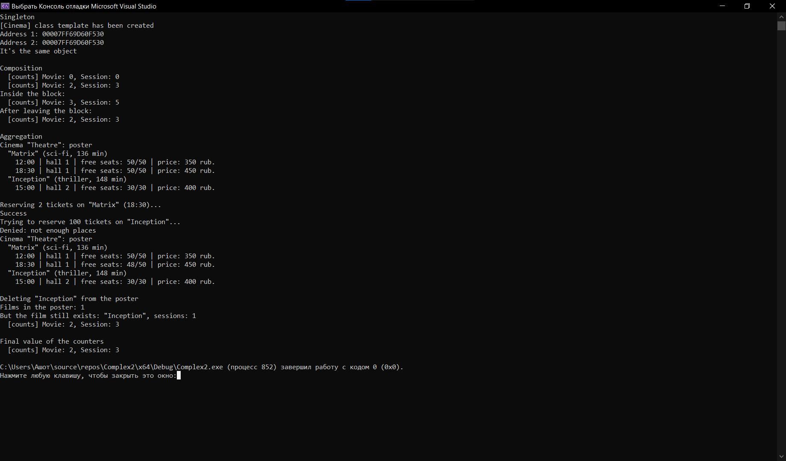

# Лабораторная работа №1: Композиция и агрегация классов. Статические члены
**Вариант:** 12
**Технология:** C++

## Содержание
- [Лабораторная работа №1: Композиция и агрегация классов. Статические члены](#лабораторная-работа-1-композиция-и-агрегация-классов-статические-члены)
  - [Содержание](#содержание)
  - [Цель работы](#цель-работы)
  - [Теоретическая часть](#теоретическая-часть)
  - [Выполнение индивидуального задания](#выполнение-индивидуального-задания)
    - [Код для индивидуального задания](#код-для-индивидуального-задания)
    - [Результат работы](#результат-работы)
  - [Ответы на вопросы](#ответы-на-вопросы)
  - [Вывод](#вывод)

## Цель работы
1. Научиться проектировать отношения между классами: композицию, агрегацию и ассоциацию 
2. Освоить реализацию композиции (поля-объекты, вложение структур) и агрегации (указатели, ссылки) 
3. Понять разницу между композицией и агрегацией с точки зрения времени жизни объектов 
4. Научиться использовать статические поля и методы для подсчёта объектов и реализации общих данных для всех экземпляров класса 
5. Получить навыки правильного управления памятью при разных типах отношений между классами

## Теоретическая часть
**Композиция** - это отношение «часть–целое», при котором «части» не могут существовать без «целого». Целое полностью контролирует время жизни частей. Ключевая характеристика: часть умирает вместе с целым. 

**Агрегация** - это отношение «часть–целое», при котором «части» могут существовать независимо от «целого» и могут принадлежать разным «целым» одновременно. Ключевая характеристика: часть может существовать без целого.

**Статическое поле** - поле класса, которое принадлежит не отдельному объекту, а всему классу в целом. Существует в единственном экземпляре для всех объектов класса. 

**Одиночка** - порождающий паттерн проектирования, который гарантирует, что у класса есть только один экземпляр.
## Выполнение индивидуального задания
В рамках индивидуального задания необходимо:
- реализовать отношение композиции или агрегации согласно варианту;
- добавить статическое поле для подсчёта объектов одного из классов; 
- реализовать паттерн «Одиночка» (Singleton) для одного из классов; 
- продемонстрировать работу всех реализованных возможностей.
Система управления кинотеатром: Cinema (одиночка) + Movie (агрегация) + Session (композиция в Movie).

### Код для индивидуального задания
System.h:
``` cpp
#ifndef CINEMA_H
#define CINEMA_H

#include <string>
#include <vector>

// Session — киносеанс. Не существует сам по себе (композиция)
class Session {
private:
  static int count_;               // статическое поле-счётчик

  std::string time_;
  int hall_;
  int totalSeats_;
  int freeSeats_;
  double price_;

public:
    Session(const std::string& time, int hall, int totalSeats, double price);
    Session(const Session& other);   
    ~Session();

    bool bookSeats(int count);       // false, если мест не хватает
    void print() const;

    const std::string& getTime() const;
    int getFreeSeats() const;

    static int getCount();           // сколько объектов Session есть сейчас
};

// Movie — фильм. Содержит сеансы по значению, но не принадлежит Cinema
class Movie {
private:
    static int count_;               // статическое поле-счётчик

    std::string title_;
    int durationMin_;
    std::string genre_;
    std::vector<Session> sessions_;  

public:
    Movie(const std::string& title, int durationMin, const std::string& genre);
    ~Movie();

    // Любая попытка вызвать функции ниже даёт ошибку компиляции.
    Movie(const Movie&) = delete;           
    Movie& operator=(const Movie&) = delete;

    void addSession(const std::string& time, int hall, int totalSeats, double price);
    bool bookTicket(size_t sessionIndex, int count);
    void print() const;

    const std::string& getTitle() const;
    size_t getSessionCount() const;

    static int getCount();           // сколько объектов Movie есть сейчас
};

// Cinema хранит указатели на фильмы, которые живут независимо
// от кинотеатра, он ими не владеет и не удаляет их. Может существовать
// только в одном экземпляре.

class Cinema {
private:
    Cinema();                        
    ~Cinema() = default; // компилятор явно генерирует стандартную реализацию 

    std::string name_;
    std::vector<Movie*> movies_;   

public:
    static Cinema& getInstance();
    
    Cinema(const Cinema&) = delete;
    Cinema& operator=(const Cinema&) = delete;

    void addMovie(Movie* movie);
    bool removeMovie(const std::string& title);   // только убирает из афиши, фильм не удаляется
    Movie* findMovie(const std::string& title) const;
    void printSchedule() const;

    const std::string& getName() const;
    size_t getMovieCount() const;  
};

#endif // CINEMA_H
```
___
System.cpp:
```cpp
#include "System.h"
#include <iostream>
#include <algorithm>

// Session 

int Session::count_ = 0;

Session::Session(const std::string& time, int hall, int totalSeats, double price)
    : time_(time), hall_(hall), totalSeats_(totalSeats),
    freeSeats_(totalSeats), price_(price) {
    ++count_;
}

Session::Session(const Session& other)
    : time_(other.time_), hall_(other.hall_), totalSeats_(other.totalSeats_),
    freeSeats_(other.freeSeats_), price_(other.price_) {
    ++count_;
}

Session::~Session() {
    --count_;
}

bool Session::bookSeats(int count) {
    if (count <= 0 || count > freeSeats_) {
        return false;
    }
    freeSeats_ -= count;
    return true;
}

void Session::print() const {
    std::cout << "    " << time_ << " | hall " << hall_
        << " | free seats: " << freeSeats_ << "/" << totalSeats_
        << " | price: " << price_ << " rub.\n";
}

const std::string& Session::getTime() const { return time_; }
int Session::getFreeSeats() const { return freeSeats_; }
int Session::getCount() { return count_; }

// Movie

int Movie::count_ = 0;

Movie::Movie(const std::string& title, int durationMin, const std::string& genre)
    : title_(title), durationMin_(durationMin), genre_(genre) {
    ++count_;
}

Movie::~Movie() {
    --count_;
    // sessions_ уничтожается автоматически вместе с Movie (композиция)
}

void Movie::addSession(const std::string& time, int hall, int totalSeats, double price) {
    sessions_.emplace_back(time, hall, totalSeats, price);   // сеанс создаётся внутри фильма
}

bool Movie::bookTicket(size_t sessionIndex, int count) {
    if (sessionIndex >= sessions_.size()) {
        return false;
    }
    return sessions_[sessionIndex].bookSeats(count);
}

void Movie::print() const {
    std::cout << "  \"" << title_ << "\" (" << genre_ << ", "
        << durationMin_ << " min)\n";
    if (sessions_.empty()) {
        std::cout << "    no sessions\n";
    }
    for (const Session& s : sessions_) {
        s.print();
    }
}

const std::string& Movie::getTitle() const { return title_; }
size_t Movie::getSessionCount() const { return sessions_.size(); }
int Movie::getCount() { return count_; }

// Cinema 

Cinema::Cinema() : name_("Cinema \"Theatre\"") {
    std::cout << "[Cinema] class template has been created\n";
}

Cinema& Cinema::getInstance() {
    static Cinema instance;   // единственный способ создать экземпляр класса Singletone 
    return instance;
}

void Cinema::addMovie(Movie* movie) {
    if (movie != nullptr && findMovie(movie->getTitle()) == nullptr) {
        movies_.push_back(movie);
    }
}

bool Cinema::removeMovie(const std::string& title) {
    auto it = std::find_if(movies_.begin(), movies_.end(),
        [&](const Movie* m) { return m->getTitle() == title; });
    if (it == movies_.end()) {
        return false;
    }
    movies_.erase(it);   // delete НЕ вызывается: кинотеатр фильмом не владеет
    return true;
}

Movie* Cinema::findMovie(const std::string& title) const {
    for (Movie* m : movies_) {
        if (m->getTitle() == title) {
            return m;
        }
    }
    return nullptr;
}

void Cinema::printSchedule() const {
    std::cout << name_ << ": poster\n";
    if (movies_.empty()) {
        std::cout << "  poster is empty\n";
    }
    for (const Movie* m : movies_) {
        m->print();
    }
}

const std::string& Cinema::getName() const { return name_; }
size_t Cinema::getMovieCount() const { return movies_.size(); }
```
___
main.cpp:
```cpp
#include "System.h"
#include <iostream>

static void printCounters() {
    std::cout << "  [counts] Movie: " << Movie::getCount()
        << ", Session: " << Session::getCount() << "\n";
}

int main() {
    // Singleton 
    std::cout << "Singleton\n";
    Cinema& cinema = Cinema::getInstance();
    Cinema& same = Cinema::getInstance();
    std::cout << "Address 1: " << &cinema << "\nAddress 2: " << &same << "\n"
        << (&cinema == &same ? "It's the same object\n" : "Different objects\n");

    // Композиция: Movie владеет Session 
    std::cout << "\nComposition\n";
    printCounters();

    Movie matrix("Matrix", 136, "sci-fi");
    matrix.addSession("12:00", 1, 50, 350);
    matrix.addSession("18:30", 1, 50, 450);

    Movie inception("Inception", 148, "thriller");
    inception.addSession("15:00", 2, 30, 400);
    printCounters();

    // Сеансы создаются только через фильм; отдельно от него их нет.
    {
        Movie temp("Temporary film", 90, "comedy");
        temp.addSession("10:00", 3, 20, 200);
        temp.addSession("20:00", 3, 20, 300);
        std::cout << "Inside the block:\n";
        printCounters();
    }   // temp уничтожен, следовательно его 2 сеанса уничтожены вместе с ним
    std::cout << "After leaving the block:\n";
    printCounters();

    // Агрегация: Cinema ссылается на Movie 
    std::cout << "\nAggregation\n";
    cinema.addMovie(&matrix);
    cinema.addMovie(&inception);
    cinema.printSchedule();

    std::cout << "\nReserving 2 tickets on \"Matrix\" (18:30)...\n";
    Movie* found = cinema.findMovie("Matrix");
    if (found != nullptr && found->bookTicket(1, 2)) {
        std::cout << "Success\n";
    }
    std::cout << "Trying to reserve 100 tickets on \"Inception\"...\n";
    std::cout << (inception.bookTicket(0, 100) ? "Success\n" : "Denied: not enough places\n");
    cinema.printSchedule();

    std::cout << "\nDeleting \"Inception\" from the poster\n";
    cinema.removeMovie("Inception");
    std::cout << "Films in the poster: " << cinema.getMovieCount() << "\n";
    std::cout << "But the film still exists: \"" << inception.getTitle()
        << "\", sessions: " << inception.getSessionCount() << "\n";
    printCounters();   // Movie и Session не изменились

    // Статические счётчики
    std::cout << "\nFinal value of the counters\n";
    printCounters();

    // Перед выходом из main убираем фильмы из афиши, чтобы у Cinema
    // (живёт до конца программы) не остались указатели на разрушенные объекты.
    cinema.removeMovie("Matrix");
    return 0;
}
```

### Результат работы

*Результат работы программы*

## Ответы на вопросы
1. Что такое композиция? Приведите пример. 
**Ответ на вопрос:** композиция - это отношение "часть-целое" со строгим владением: часть не существует без целого, создаётся им и уничтожается вместе с ним. Пример: дом и комнаты.
2. Что такое агрегация? Чем она отличается от композиции? 
**Ответ на вопрос:** агрегация - это отношение "часть-целое" со слабой связью: целое лишь ссылается на части, но не владеет ими. Части существуют независимо и могут принадлежать нескольким целым сразу.
3. Как реализовать композицию в C++? Приведите пример кода. 
**Ответ на вопрос:** 
```cpp
class Movie {
    std::vector<Session> sessions_;   // сеансы лежат внутри фильма
public:
    void addSession(const std::string& t, int hall, int seats, double price) {
        sessions_.emplace_back(t, hall, seats, price);   // создаёт сам Movie
    }
};
```
4. Как реализовать агрегацию в C++? Приведите пример кода. 
**Ответ на вопрос:**
```cpp 
class Cinema {
    std::vector<Movie*> movies_;      // только указатели
public:
    void addMovie(Movie* m) { movies_.push_back(m); }
    // деструктор не делает delete
};
```
5. В чём разница между временем жизни частей при композиции и агрегации? 
**Ответ на вопрос:** при композиции время жизни части равно времени жизни целого, а при агрегации время жизни независимо. 
6. Что такое статическое поле класса? Чем оно отличается от обычного поля? 
**Ответ на вопрос:** статическим является поле, принадлежащее самому классу, а не объектам. Существует в единственном экземпляре и общее для всех объектов. Обычное поле у каждого объекта своё. 
7. Как объявить и определить статическое поле? Где оно хранится? 
**Ответ на вопрос:** Объявление внутри класса со словом static, определение (с выделением памяти) один раз вне класса, в .cpp.
8. Что такое статический метод? Можно ли из него обратиться к 
нестатическим полям? 
**Ответ на вопрос:** статическим называется метод, который вызывается без объекта (Movie::getCount()). У него нет указателя this, поэтому напрямую к нестатическим полям обратиться нельзя.
9. Для чего используются статические счётчики объектов? 
**Ответ на вопрос:** для подсчёта "живых" объектов, генерации уникальных ID, ограничения числа объектов, отладки (поиск утечек: счётчик не вернулся к нулю) и наглядной демонстрации жизненного цикла. Важно увеличивать счётчик во всех конструкторах, включая копирующий, и уменьшать в деструкторе.
10.  Что такое паттерн «Одиночка» (Singleton)? Для чего он нужен? 
**Ответ на вопрос:** Singleton - это порождающий паттерн: у класса может быть только один экземпляр, и к нему есть глобальная точка доступа. Применяют, когда нужен единственный объект на всю программу
11.  Как запретить создание копий объекта (конструктор копирования)? 
**Ответ на вопрос:** удалить конструктор копирования и оператор присваивания:
```cpp
Movie(const Movie&) = delete;
Movie& operator=(const Movie&) = delete;
```
12.  В каком порядке вызываются конструкторы и деструкторы при композиции? 
**Ответ на вопрос:** для конструкторов сначала создаются части (в порядке объявления полей в классе, а не в списке инициализации), затем выполняется тело конструктора целого. Деструкторы идут в обратном порядке: сначала тело деструктора целого, затем части в обратном порядке объявления.
13.  Можно ли изменить статическое поле из обычного метода? 
**Ответ на вопрос:** да, обычный метод имеет доступ ко всем членам класса, включая статические, (благодаря этому и работает счётчик в конструкторе).
14.  Почему статические поля нужно определять вне класса? 
**Ответ на вопрос:** внутри класса статическое поле лишь объявлено, то есть сказано, что оно существует. Память под него должна быть выделена ровно в одном месте программы (правило одного определения, ODR). Заголовочный файл включается во множество .cpp, и определение внутри класса создало бы много копий, что привело бы к ошибке линковки (multiple definition),поэтому определение выносят в один .cpp.
15.  В каких случаях стоит использовать композицию, а в каких - агрегацию? 
**Ответ на вопрос:** композицию стоит использовать, если часть бессмысленна без целого, не должна быть общей и должна удаляться вместе с ним (сеанс без фильма, комната без дома, строка заказа без заказа), а агрегацию, если объект живёт сам по себе и может быть связан с несколькими другими, а целое лишь использует его: фильм и кинотеатр, преподаватель и кафедра, студент и группа.

## Вывод 
В ходе выполнения лабораторной работы были получены навыки проектирования отношений между классами (композиция, агрегация и ассоциация) и правильного управления памяти в их различных типах, освоена реализация композиции и ассоциации, получены навыки, отработаны способы применения статических полей для подсчёта объектов и реализации общих данных для экземпляров класса.
