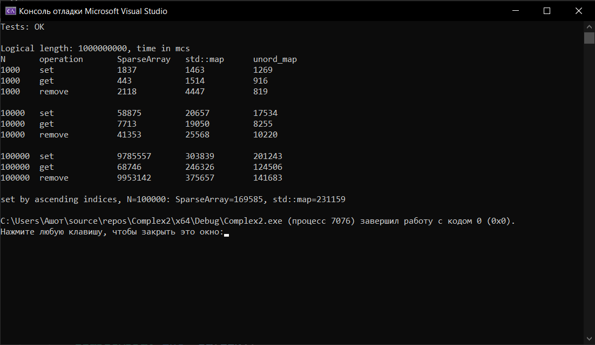

# Лабораторная работа №2: Анализ сложности алгоритмов. Шаблоны классов
**Студент:** Степанян Даниел Эрнестович
**Группа:** ПИЖ-б-о-25-2
**Вариант:** 12
**Технология:** C++

## Содержание
- [Лабораторная работа №2: Анализ сложности алгоритмов. Шаблоны классов](#лабораторная-работа-2-анализ-сложности-алгоритмов-шаблоны-классов)
	- [Содержание](#содержание)
	- [Цель работы](#цель-работы)
	- [Теоретическая часть](#теоретическая-часть)
	- [Выполнение индивидуального задания](#выполнение-индивидуального-задания)
		- [Код для индивидуального задания](#код-для-индивидуального-задания)
		- [Результат работы](#результат-работы)
	- [Ответы на вопросы](#ответы-на-вопросы)
	- [Вывод](#вывод)

## Цель работы
1. Научиться оценивать эффективность алгоритмов с помощью Онотации (Big O).
2. Освоить классы сложности: O(1), O(log n), O(n), O(n log n), O(n²).
3. Научиться проводить экспериментальный анализ производительности алгоритмов.
4. Освоить создание шаблонов функций и классов для работы с различными типами данных.
5. Получить навыки сравнения производительности различных реализаций одной задачи.

## Теоретическая часть
**Анализ сложности** - это математический способ оценки эффективности алгоритма в зависимости от размера входных данных. Два вида сложности:
1. временная сложность (Time Complexity) - сколько времени выполняется алгоритм;
2. пространственная сложность (Space Complexity) - сколько памяти использует алгоритм.

**О-нотация** - это математическая запись, описывающая асимптотическое поведение функции при стремлении аргумента к бесконечности.

**Шаблоны** представляют собой обобщённое описание, по которому компилятор генерирует версии функции или класса для конкретных типов.
## Выполнение индивидуального задания
В рамках индивидуального задания необходимо:
- реализовать шаблонный контейнер с заданной функциональностью;
- провести анализ сложности каждой операции;
- экспериментально сравнить производительность с аналогом из STL.
SparseArray<T> set, get, remove, size (разрежённый массив).

### Код для индивидуального задания
``` cpp
#include <iostream>
#include <iomanip>				// для форматирования таблицы setw
#include <chrono>				// для функций измерения времени
#include <vector>				
#include <map>					// для сравнений (бинарное дерево)
#include <unordered_map>		// для сравнений (хеш-таблица)
#include <random>	
#include <stdexcept>
#include <algorithm>			// для shuffle (перемешивание порядка запросов)

using namespace std;
using namespace chrono;

// SparseArray<T> - разрежённый массив, хранящий только явно заданные элементы 
// в виде отсортированного по индексу вектора пар (index, value). 
// Все остальные позиции считаются равными значению по умолчанию.
//
// Пусть k - число хранимых элементов, L - логическая длина.
//   set(i, v)    : O(log k) поиск + O(k) сдвиг при вставке нового
//                  индекса (O(log k), если индекс уже есть;
//                  O(1) амортизированно при вставке в конец)
//   get(i)       : O(log k)
//   remove(i)    : O(log k) поиск + O(k) сдвиг
//   size()       : O(1)
//   Память       : O(k), не зависит от L

template <typename T>
class SparseArray {
	struct Entry {
		size_t index;
		T value;
	};
	vector<Entry> data_;
	size_t length_;
	T default_;

	// Это ручная реализация std::lower_bound: бинарный поиск первой позиции, где data_[pos].index >= i.
	// O(log k)
	size_t lowerBound(size_t i) const {
		size_t lo = 0, hi = data_.size();
		while (lo < hi) {
			size_t mid = lo + (hi - lo) / 2;
			if (data_[mid].index < i) lo = mid + 1;
			else hi = mid;
		}
		return lo;
	}

	// Бросает out_of_range, если i >= length_. Проверка идёт по логической длине, а не по размеру вектора.
	void check(size_t i) const {
		if (i >= length_) throw out_of_range("SparseArray: index out of range");
	}

public:
	explicit SparseArray(size_t length, const T& def = T())
		: length_(length), default_(def) {
	}

	// Поиск: O(log k). Обновление существующего: O(1) после поиска. Вставка нового в середину: vector::insert сдвигает все элементы правее на одну позицию, то есть O(k).
	// Вставка в конец (индексы по возрастанию): сдвигать нечего, амортизированно O(1).
	void set(size_t i, const T& v) {
		check(i);
		size_t pos = lowerBound(i);
		if (pos < data_.size() && data_[pos].index == i)
			data_[pos].value = v;								// обновление
		else
			data_.insert(data_.begin() + pos, Entry{ i, v });	// вставка
	}

	// Находит позицию через lowerBound. Если индекс найден, возвращает значение, иначе default_. Возвращается const T&, то есть копирования нет. Ссылка на default_ работает, пока жив сам объект. Сложность O(log k).
	const T& get(size_t i) const {
		check(i);
		size_t pos = lowerBound(i);
		if (pos < data_.size() && data_[pos].index == i)
			return data_[pos].value;
		return default_;
	}

	// Ищет позицию, при совпадении индекса делает erase (сдвиг влево, O(k)) и возвращает true. Если элемента не было, возвращает false. O(log k) + O(k).
	bool remove(size_t i) {
		check(i);
		size_t pos = lowerBound(i);
		if (pos < data_.size() && data_[pos].index == i) {
			data_.erase(data_.begin() + pos);
			return true;
		}
		return false;
	}

	size_t size() const { return data_.size(); }   // число хранимых элементов
	size_t length() const { return length_; }      // kогическая длина массива
};

// Измерение времени
template <typename Func>
long long measureTime(Func func) {
	auto start = high_resolution_clock::now();
	func();
	auto end = high_resolution_clock::now();
	return duration_cast<microseconds>(end - start).count();
}

// Проверка на массиве длиной 10^9 методов и пограничных значений
// Функциональные тесты
void testCorrectness() {
	SparseArray<int> a(1000000000, -1);
	a.set(5, 10);
	a.set(999999999, 20);
	a.set(5, 11);
	bool ok = a.get(5) == 11 && a.get(999999999) == 20 && a.get(7) == -1
		&& a.size() == 2 && a.remove(5) && !a.remove(5) && a.size() == 1
		&& a.get(5) == -1;
	bool thrown = false;
	try { a.get(1000000000); }				// безопасная обработка исключений
	catch (const out_of_range&) { thrown = true; }
	cout << "Tests: " << ((ok && thrown) ? "OK" : "FAIL") << "\n\n";
}

// Эксперимент
volatile long long sink;			// чтобы компилятор не выкинул вызовы get

int main() {
	setlocale(LC_ALL, "RU");
	testCorrectness();

	const size_t LEN = 1000000000;					// логическая длина
	cout << "Logical length: " << LEN << ", time in mcs\n";
	cout << left << setw(8) << "N"
		<< setw(16) << "operation"
		<< setw(14) << "SparseArray"
		<< setw(14) << "std::map"
		<< setw(14) << "unord_map" << "\n";

	for (size_t N : { 1000u, 10000u, 100000u }) {
		mt19937_64 rng(42);
		vector<size_t> keys(N);
		for (auto& k : keys) k = rng() % LEN;
		vector<size_t> probe = keys;				// порядок для get/remove
		shuffle(probe.begin(), probe.end(), rng);

		SparseArray<int> sa(LEN);
		map<size_t, int> m;
		unordered_map<size_t, int> um;

		// set
		long long t1 = measureTime([&] { for (size_t k : keys) sa.set(k, 1); });
		long long t2 = measureTime([&] { for (size_t k : keys) m[k] = 1; });
		long long t3 = measureTime([&] { for (size_t k : keys) um[k] = 1; });
		cout << setw(8) << N << setw(16) << "set"
			<< setw(14) << t1 << setw(14) << t2 << setw(14) << t3 << "\n";

		// get
		t1 = measureTime([&] { long long s = 0; for (size_t k : probe) s += sa.get(k); sink = s; });
		t2 = measureTime([&] { long long s = 0; for (size_t k : probe) { auto it = m.find(k); if (it != m.end()) s += it->second; } sink = s; });
		t3 = measureTime([&] { long long s = 0; for (size_t k : probe) { auto it = um.find(k); if (it != um.end()) s += it->second; } sink = s; });
		cout << setw(8) << N << setw(16) << "get"
			<< setw(14) << t1 << setw(14) << t2 << setw(14) << t3 << "\n";

		// remove
		t1 = measureTime([&] { for (size_t k : probe) sa.remove(k); });
		t2 = measureTime([&] { for (size_t k : probe) m.erase(k); });
		t3 = measureTime([&] { for (size_t k : probe) um.erase(k); });
		cout << setw(8) << N << setw(16) << "remove"
			<< setw(14) << t1 << setw(14) << t2 << setw(14) << t3 << "\n\n";
	}

	// Лучший случай для SparseArray: индексы идут по возрастанию (вставка в конец)
	{
		const size_t N = 100000;
		SparseArray<int> sa(LEN);
		map<size_t, int> m;
		long long t1 = measureTime([&] { for (size_t i = 0; i < N; i++) sa.set(i * 1000, 1); });
		long long t2 = measureTime([&] { for (size_t i = 0; i < N; i++) m[i * 1000] = 1; });
		cout << "set by ascending indices, N=" << N
			<< ": SparseArray=" << t1 << ", std::map=" << t2 << "\n";
	}
	return 0;
}
```

### Результат работы

*Результат работы программы*

## Ответы на вопросы
1. Что такое О-нотация (Big O) и зачем она нужна?
Big O описывает, как растёт время работы (или расход памяти) алгоритма при росте размера входных данных n. Это верхняя асимптотическая оценка: отбрасываются константы и младшие слагаемые. Она нужна для сравнения алгоритмов независимо от железа, компилятора и языка, и чтобы заранее понять, выдержит ли решение большие данные.

2. Какая сложность у доступа к элементу массива по индексу? Почему?
O(1). Элементы лежат в памяти последовательно. Это одна арифметическая операция, не зависящая от размера массива.

3. Какая сложность у бинарного поиска? Почему?
O(log n). Массив должен быть отсортирован. На каждом шаге сравнивается искомое с средним элементом и отбрасывается половину диапазона.

4. Что означает сложность O(n log n)? Приведите пример алгоритма
Время растёт чуть быстрее линейного: порядка n операций, умноженных на log n. Типичный случай - «разделяй и властвуй»: log n уровней рекурсии, на каждом уровне суммарно O(n) работы. Примером является сортировка слиянием (merge sort). Также std::sort в среднем работает за O(n log n).

5. Что такое амортизированный анализ? Приведите пример.
Это оценка средней стоимости операции на длинной последовательности операций, когда редкие операции дороги, а большинство дёшевы. Оценка гарантирована для худшей последовательности.
Пример: std::vector::push_back. Обычно это O(1), но при заполнении буфера происходит перевыделение с копированием n элементов. Если ёмкость удваивается, то за n вставок суммарные копирования составят в среднем O(1) на вставку.

6. Какая сложность у двух вложенных циклов по n итераций каждый?
O(n^2): внутренний цикл выполняется n раз на каждую из n итераций внешнего.

7. Какая сложность у рекурсивного вычисления чисел Фибоначчи?
Явная реализация fib(n) = fib(n-1) + fib(n-2) работает за экспоненциальное время, O(2^n) (точнее O(ф^2), где ф = 1,618): одни и те же подзадачи пересчитываются многократно, дерево вызовов ветвится в два раза на каждом уровне.

8. Что такое шаблоны функций? Как их объявить и использовать?
Шаблон функции - обобщённое описание, по которому компилятор генерирует версии функции для конкретных типов.

``` cpp
template <typename T>
T maxOf(T a, T b) {
    return (a > b) ? a : b;
}

int main() {
    maxOf(3, 5);            // T = int (выведен автоматически)
    maxOf(2.5, 1.1);        // T = double
    maxOf<double>(3, 2.5);  // явное указание типа
}
```

9. Что такое шаблоны классов? Как их объявить и использовать?
Шаблон классов - обобщённое описание, по которому компилятор генерирует версии класса для конкретных типов. При использовании тип обычно указывается явно.

``` cpp
template <typename T>
class Stack {
    std::vector<T> data;
public:
    void push(const T& v) { data.push_back(v); }
    T pop() { T v = data.back(); data.pop_back(); return v; }
    bool empty() const { return data.empty(); }
};

Stack<int> s;
s.push(10);
Stack<std::string> names;
```

10. В чём преимущество шаблонов перед перегрузкой функций?
Не нужно копировать один и тот же код для каждого типа: один шаблон вместо десятков перегрузок.
Работает и с типами, которые появятся позже (в том числе пользовательскими), без изменения исходной функции.
Меньше ошибок при сопровождении: исправление делается в одном месте.
Генерация происходит на этапе компиляции, поэтому нет накладных расходов времени выполнения.

11. Как указать, что шаблонный параметр - тип?
Ключевым словом typename:
```template <typename T>```.
Параметр может быть и не типом, например template \<int N\>. Кроме того, typename нужен внутри шаблона для зависимых имён: typename T::value_type.

12. Можно ли создать шаблон с несколькими параметрами типов?
Да, можно:
``` cpp
template <typename K, typename V>
struct Pair {
    K key;
    V value;
};

Pair<std::string, int> p{"age", 30};

template <typename A, typename B>
auto add(A a, B b) { return a + b; }
```

13. Как провести экспериментальное измерение времени
выполнения?
С помощью библиотек std::chrono и часы steady_clock:
``` cpp
#include <chrono>
#include <iostream>

auto start = std::chrono::steady_clock::now();
doWork();
auto end = std::chrono::steady_clock::now();

auto us = std::chrono::duration_cast<std::chrono::microseconds>(end - start).count();
std::cout << us << " мкс\n";
```
Измерения проводят на сборке с оптимизациями, а результат вычислений используют (например, выводят), чтобы компилятор не вырезал код как неиспользуемый.

14. Почему при измерении времени нужно выполнять операцию
многократно?
Разрешение таймера конечно, и одна быстрая операция может быть короче его шага.
Есть шум: планировщик ОС, прерывания, фоновые процессы.
Первый запуск проходит с пустыми кэшами процессора, подгрузкой страниц памяти - предсказатель переходов не обучен, поэтому делают прогревочный запуск, затем много повторов и берут медиану (иногда минимум), а общее время делят на число повторов.

15.  Что важнее: сложность алгоритма или константа?
Для больших n важнее асимптотика: алгоритм O(n log n) рано или поздно обгонит O(n^2), какой бы малой ни была константа у второго. Для малых n или в критичных по времени участках константа (локальность кэша, аллокации, ветвления) может быть решающей: например, на коротких массивах сортировка вставками быстрее быстрой сортировки, поэтому std::sort переключается на неё для маленьких подотрезков.

## Вывод 
В ходе выполнения лабораторной работы были получены навыки оценки эффективности алгоритмов с помощью О-нотации (Big O), проведения экспериментального анализа производительности алгоритмов и сравнения производительности различных реализаций одной задачи, освоены классы сложности и создания шаблонов функций и классов для работы с различными типами данных.
