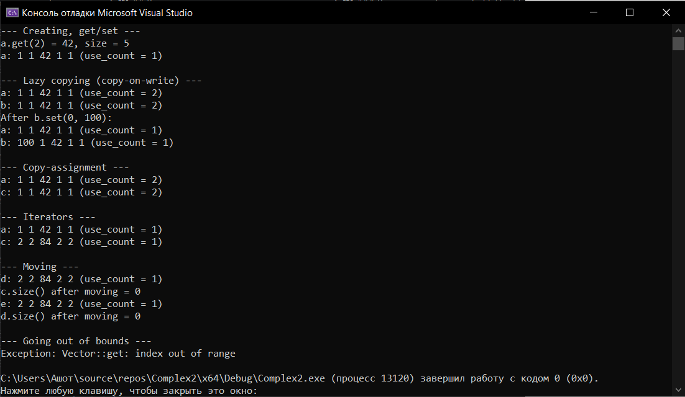

# Лабораторная работа №3: Реализация динамического массива (аналог vector). Итераторы
**Вариант:** 12
**Технология:** C++

## Содержание
- [Лабораторная работа №3: Реализация динамического массива (аналог vector). Итераторы](#лабораторная-работа-3-реализация-динамического-массива-аналог-vector-итераторы)
	- [Содержание](#содержание)
	- [Цель работы](#цель-работы)
	- [Теоретическая часть](#теоретическая-часть)
	- [Выполнение индивидуального задания](#выполнение-индивидуального-задания)
		- [Код для индивидуального задания](#код-для-индивидуального-задания)
		- [Результат работы](#результат-работы)
	- [Ответы на вопросы](#ответы-на-вопросы)
	- [Вывод](#вывод)

## Цель работы
1. Реализовать шаблонный класс Vector<T> - аналог std::vector - с нуля. 
2. Освоить управление динамической памятью: выделение, расширение, освобождение. 
3. Закрепить «правило трёх» (деструктор, конструктор копирования, оператор присваивания) и освоить «правило пяти» (конструктор и оператор перемещения). 
4. Реализовать итераторы для поддержки range-based for и STL-совместимости. 
5. Провести амортизированный анализ операции push_back.

## Теоретическая часть
**Динамический массив** - это структура данных, которая хранит элементы в непрерывной области памяти, но в отличие от статического массива может изменять свой размер во время выполнения программы. 

**Правило трёх:** деструктор, конструктор копирования, оператор присваивания копированием. 
**Правило пяти:** правило трёх + конструктор перемещения, оператор присваивания перемещением. 

**Итератор** - объект, который указывает на элемент контейнера и позволяет перебирать элементы последовательно.

## Выполнение индивидуального задания
В рамках индивидуального задания необходимо реализовать класс Vector с поддержкой «правила пяти», итераторами и ленивым копированием (copy-on-write).
### Код для индивидуального задания
**Vector.h**
``` cpp
#ifndef VECTOR_H

#define VECTOR_H

#include <cstddef>
#include <memory>

// Вектор целых чисел с ленивым копированием (copy-on-write).
// Копии разделяют один буфер, пока кто-то из них не попытается его изменить.
class Vector {
private:
    void detach();
    
    // shared_ptr - умный указатель, который владеет динамически выделенным объектом 
    // и сам освобождает его, когда на него не остаётся владельцев. Ручной delete не нужен.
    std::shared_ptr<int[]> data_;
    std::size_t size_;
public:
    using iterator = int*;
    using const_iterator = const int*;

    // Конструктор: size элементов, заполненных value
    explicit Vector(std::size_t size = 0, int value = 0);

    // Правило пяти
    ~Vector();
    Vector(const Vector& other);                    
    Vector(Vector&& other) noexcept;                    // noexcept - обещание компилятору,
    Vector& operator=(const Vector& other);             // что функция не выбросит исключение
    Vector& operator=(Vector&& other) noexcept;         
    // && обозначает ссылку, которая может привязываться к временным объектам
    
    // Базовые методы
    int get(std::size_t index) const;
    void set(std::size_t index, int value);
    std::size_t size() const;

    // Сколько объектов Vector сейчас делят этот буфер (для демонстрации COW)
    long use_count() const;

    // Итераторы.
    // Неконстантные begin()/end() дают доступ на запись, поэтому
    // сначала «отделяют» буфер, если он общий.
    iterator begin();
    iterator end();
    const_iterator begin() const;
    const_iterator end() const;
    const_iterator cbegin() const;
    const_iterator cend() const;
};

#endif
```
___
**Vector.cpp**
``` cpp
#include "Vector.h"

#include <algorithm>
#include <stdexcept>
#include <utility>

Vector::Vector(std::size_t size, int value) : data_(nullptr), size_(size) {
    if (size_ > 0) {
        data_.reset(new int[size_]);
        std::fill(data_.get(), data_.get() + size_, value);
    }
}

// default просит компилятор сгенерировать стандартную реализацию специальной функции-члена
Vector::~Vector() = default;  // shared_ptr сам уменьшит счётчик и освободит память

// Копирование ленивое: просто делим буфер с other
Vector::Vector(const Vector& other) : data_(other.data_), size_(other.size_) {}

Vector::Vector(Vector&& other) noexcept
    : data_(std::move(other.data_)), size_(other.size_) {
    other.data_.reset();
    other.size_ = 0;
}

Vector& Vector::operator=(const Vector& other) {
    if (this != &other) {
        data_ = other.data_;
        size_ = other.size_;
    }
    return *this;
}

Vector& Vector::operator=(Vector&& other) noexcept {
    if (this != &other) {
        data_ = std::move(other.data_);
        size_ = other.size_;
        other.data_.reset();
        other.size_ = 0;
    }
    return *this;
}

int Vector::get(std::size_t index) const {
    if (index >= size_) {
        throw std::out_of_range("Vector::get: index out of range");
    }
    return data_[index];
}

void Vector::set(std::size_t index, int value) {
    if (index >= size_) {
        throw std::out_of_range("Vector::set: index out of range");
    }
    detach();  // перед записью получаем собственную копию, если буфер общий
    data_[index] = value;
}

std::size_t Vector::size() const { return size_; }

long Vector::use_count() const { return data_.use_count(); }

Vector::iterator Vector::begin() {
    detach();
    return data_.get();
}

Vector::iterator Vector::end() {
    detach();
    return data_.get() + size_;
}

Vector::const_iterator Vector::begin() const { return data_.get(); }
Vector::const_iterator Vector::end() const { return data_.get() + size_; }
Vector::const_iterator Vector::cbegin() const { return data_.get(); }
Vector::const_iterator Vector::cend() const { return data_.get() + size_; }

// Ленивое копирование - стратегия дублирования данных, 
// при которой реальное создание независимой копии откладывается до того момента, 
// пока данные не попытаются изменить.
void Vector::detach() {
    // Проверяем, что буфер существует и им владеет больше одного объекта
    if (data_ && data_.use_count() > 1) {
        std::shared_ptr<int[]> copy(new int[size_]);                // выделяем новый буфер того же размера
        std::copy(data_.get(), data_.get() + size_, copy.get());    // копируем все элементы из общего буфера.
        data_ = std::move(copy);                                    // переключаем data_ на новый буфер; 
    // Счётчик старого буфера уменьшается на 1 (другие векторы продолжают им пользоваться), 
    // а у нового счётчик равен 1.
    }
}
```
___
**main.cpp**
``` cpp
#include <iostream>
#include <utility>

#include "Vector.h"

void print(const char* name, const Vector& v) {
    std::cout << name << ": ";
    for (auto it = v.begin(); it != v.end(); ++it) {  // константные итераторы
        std::cout << *it << ' ';
    }
    std::cout << "(use_count = " << v.use_count() << ")\n";
}

int main() {
    std::cout << "--- Creating, get/set ---\n";
    Vector a(5, 1);
    a.set(2, 42);
    std::cout << "a.get(2) = " << a.get(2) << ", size = " << a.size() << "\n";
    print("a", a);

    std::cout << "\n--- Lazy copying (copy-on-write) ---\n";
    Vector b = a;               // копирующий конструктор: буфер общий
    print("a", a);
    print("b", b);

    b.set(0, 100);              // запись -> b получает собственную копию
    std::cout << "After b.set(0, 100):\n";
    print("a", a);
    print("b", b);

    std::cout << "\n--- Copy-assignment ---\n";
    Vector c;
    c = a;
    print("a", a);
    print("c", c);

    std::cout << "\n--- Iterators ---\n";
    for (auto& x : c) {         // begin() отделяет буфер c от a
        x *= 2;
    }
    print("a", a);
    print("c", c);

    std::cout << "\n--- Moving ---\n";
    Vector d = std::move(c);    // перемещающий конструктор
    print("d", d);
    std::cout << "c.size() after moving = " << c.size() << "\n";

    Vector e;
    e = std::move(d);           // перемещающее присваивание
    print("e", e);
    std::cout << "d.size() after moving = " << d.size() << "\n";

    std::cout << "\n--- Going out of bounds ---\n";
    try {
        a.get(10);
    }
    catch (const std::out_of_range& ex) {
        std::cout << "Exception: " << ex.what() << "\n";
    }

    return 0;
}
```
___
### Результат работы

*Результат работы программы*

## Ответы на вопросы
1. Почему динамический массив называется «динамическим»?
Динамический массив называется так, потому что его размер выделенной памяти может изменяться во время выполнения программы.
В отличие от обычного массива фиксированного размера, динамический массив можно расширять, когда в нём заканчивается место, или уменьшать при необходимости.
Если массиву нужно больше места, можно выделить новый участок памяти, скопировать туда элементы и освободить старый участок.
2. Что такое ёмкость (capacity) и чем она отличается от размера (size)?
- size - количество элементов, которые фактически находятся в массиве.
- capacity - количество элементов, для которых уже выделена память.
Например, если size = 3, а capacity = 8, то в массиве хранятся 3 элемента, но память выделена для 8.
Когда количество элементов достигает ёмкости, массив необходимо расширить, чтобы добавить новые элементы.
3. Почему при расширении массива ёмкость удваивается, а не увеличивается на фиксированное число?
Удвоение ёмкости позволяет уменьшить количество перераспределений памяти и копирований элементов. При добавлении большого количества элементов придётся часто выделять новую память и копировать все существующие элементы. При удвоении ёмкости размеры будут изменяться так: 1 - 2 - 4 - 8 - 16 - 32 - 64.
Количество расширений при этом растёт значительно медленнее. Удвоение позволяет получить амортизированную сложность добавления элемента (O(1)).
4. Какова амортизированная сложность операции push_back? Почему?
Амортизированная сложность push_back() - (O(1)), то есть постоянная в среднем на последовательность операций.
Если свободное место есть, новый элемент добавляется за (O(1)).
Если места нет, приходится выделить новый участок памяти, перенести существующие элементы, освободить старую память, добавить новый элемент. Такое расширение занимает (O(n)), где (n) - количество элементов.
Однако расширения происходят редко. При удвоении ёмкости общее количество переносов за (n) добавлений ограничено величиной порядка (n), поэтому средняя стоимость одной операции на длинной последовательности составляет (O(1)), хотя отдельный вызов может иметь сложность (O(n)).
5. Что такое «правило трёх»? Когда оно применяется?
Правило трёх (Rule of Three) гласит: если классу требуется самостоятельно реализовать хотя бы один из следующих трёх специальных методов, обычно необходимо продумать реализацию всех трёх:
   - деструктор - освобождает принадлежащие объекту ресурсы;
   - конструктор копирования - создаёт новый объект на основе существующего;
   - рператор копирующего присваивания - копирует данные в уже существующий объект.
Правило применяется, когда класс самостоятельно управляет ресурсами, например динамической памятью.

6. Что такое «правило пяти»? Чем оно отличается от «правила трёх»?
Правило пяти (Rule of Five) расширяет правило трёх, добавляя два метода, связанные с перемещением ресурсов:
	- деструктор;
    - конструктор копирования;
    - оператор копирующего присваивания.
    - конструктор перемещения;
    - оператор перемещающего присваивания;
Конструктор перемещения позволяет передать ресурсы новому объекту без полного копирования данных.
Правило пяти применяется, когда класс самостоятельно управляет ресурсами и необходимо корректно поддержать как копирование, так и перемещение.
7. В чём разница между конструктором копирования и оператором присваивания?
Конструктор копирования создаёт новый объект на основе уже существующего.
``` cpp
MyArray a(5);
MyArray b = a; // Вызов конструктора копирования
```
Оператор присваивания изменяет уже существующий объект, копируя в него содержимое другого объекта.
```cpp 
MyArray a(5);
MyArray b(3);
b = a; // Вызов оператора копирующего присваивания
```
8. Зачем нужна проверка if (this != &other) в операторе присваивания?
Она проверяет, не присваивается ли объект сам себе.
a = a;
Здесь this - указатель на текущий объект, а &other - адрес объекта, из которого выполняется копирование. Без проверки можно случайно удалить память объекта до того, как данные будут скопированы из него. Это приведёт к ошибкам.
9. Что такое итератор? Как он связан с указателем?
Итератор - это объект, который позволяет последовательно обращаться к элементам контейнера и перемещаться между ними.
Например:
```cpp
int arr[] = {10, 20, 30};
int* it = arr;
cout << *it; // 10
++it;
cout << *it; // 20
```
Указатель - один из возможных видов итератора, а итератор - более общее понятие.
10.  Зачем нужны методы begin() и end()?
Эти методы задают диапазон элементов контейнера.
- begin() возвращает итератор на первый элемент.
- end() возвращает итератор на позицию сразу после последнего элемента.
Например:
``` cpp
int arr[] = {10, 20, 30};
int* begin = arr;
int* end = arr + 3;
```
Диапазон [begin, end) включает первый указатель, но не включает end.
Такой подход позволяет удобно перебирать элементы:
``` cpp
for (auto it = arr.begin(); it != arr.end(); ++it) {
    cout << *it << ' ';
}
```
11. Как реализовать range-based for для своего контейнера?
Чтобы использовать контейнер в цикле вида
``` cpp
for (auto x : container) {
    cout << x << ' ';
}
```
обычно достаточно реализовать методы begin() и end(), возвращающие итераторы.
12. Что такое «глубокое копирование»? Чем оно отличается от «поверхностного»?
Поверхностное копирование (shallow copy) копирует значения полей объекта. Если поле является указателем, копируется сам адрес, а не данные по этому адресу.
Глубокое копирование (deep copy) создаёт отдельную область памяти и копирует в неё данные.
13. Что такое семантика перемещения и зачем она нужна?
Семантика перемещения (move semantics) позволяет передавать ресурсы от одного объекта другому без дорогостоящего копирования самих данных.
Она появилась в C++11.
``` cpp
#include <vector>
#include <utility>

std::vector<int> a = {1, 2, 3, 4, 5};

std::vector<int> b = std::move(a);
```
Вместо копирования всех элементов в новый вектор реализация может передать ему владение внутренним буфером исходного вектора.
После перемещения объект a остаётся корректным объектом, но его содержимое не следует считать прежним. Для стандартных контейнеров обычно можно безопасно присваивать новое значение или вызывать методы, не нарушая их предусловий.
Перемещение полезно при возврате объектов из функций, передаче временных объектов и работе с большими контейнерами.
14. Почему конструктор перемещения помечается noexcept?
noexcept означает, что функция не должна выбрасывать исключения.
Конструктор перемещения часто можно сделать noexcept, потому что он просто передаёт указатели и размеры, не выделяя память и не копируя элементы.
Это особенно важно для std::vector: при перераспределении памяти он может предпочесть перемещение элементов копированию, если перемещение гарантированно не выбрасывает исключения. Для типов, у которых перемещение может выбрасывать исключения, std::vector нередко использует копирование, если оно доступно, чтобы сохранить гарантию исключительной безопасности.
15. Как правильно освобождать память в деструкторе?
Если класс выделяет память с помощью new[], освобождать её нужно с помощью delete[] в деструкторе.

## Вывод 
В ходе выполнения лабораторной работы были получены навыки реализации шаблонного класса Vector<T> - аналога std::vector, освоено управление динамической памятью (выделение, расширение, освобождение), закреплено «правило трёх» (деструктор, конструктор копирования, оператор присваивания) и «правило пяти» (конструктор и оператор перемещения), реализованы итераторы для поддержки range-based for и STL-совместимости. 
