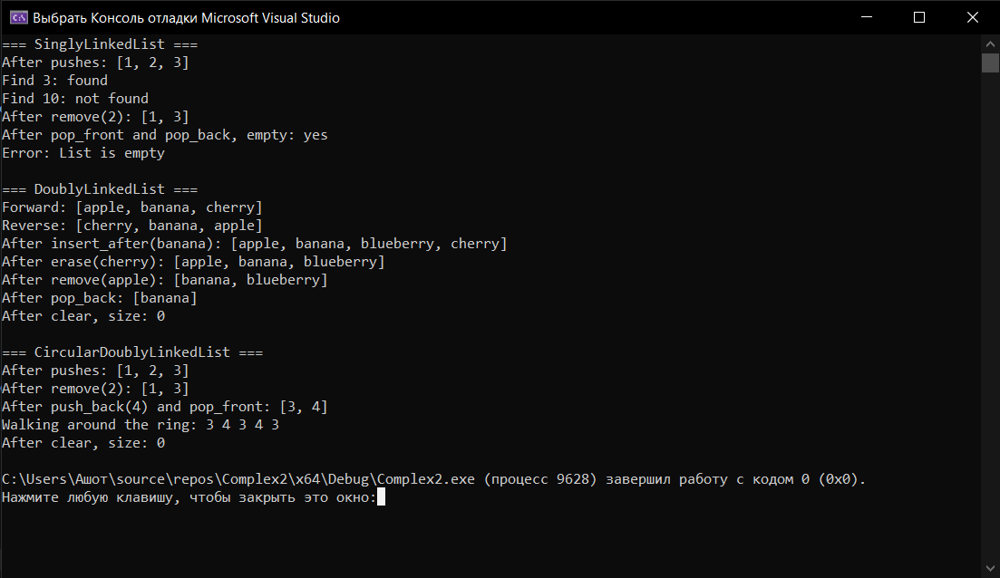

# Лабораторная работа №4: Односвязный и двусвязный списки
**Студент:** Степанян Даниел Эрнестович
**Группа:** ПИЖ-б-о-25-2
**Вариант:** 12
**Технология:** C++

## Содержание
- [Лабораторная работа №4: Односвязный и двусвязный списки](#лабораторная-работа-4-односвязный-и-двусвязный-списки)
  - [Содержание](#содержание)
  - [Цель работы](#цель-работы)
  - [Теоретическая часть](#теоретическая-часть)
  - [Выполнение индивидуального задания](#выполнение-индивидуального-задания)
    - [Код для индивидуального задания](#код-для-индивидуального-задания)
    - [Результат работы](#результат-работы)
  - [Ответы на вопросы](#ответы-на-вопросы)
  - [Вывод](#вывод)

## Цель работы
1. Реализовать шаблонный класс односвязного списка (SinglyLinkedList) с базовыми операциями.
2. Реализовать шаблонный класс списка двусвязного (DoublyLinkedList) с базовыми операциями. 
3. Освоить операции вставки, удаления, поиска и обхода элементов в списках. 
4. Сравнить производительность и особенности использования односвязного и двусвязного списков. 
5. Научиться правильно управлять памятью при работе со списками (удаление узлов).

## Теоретическая часть
**Связный список** - это структура данных, в которой элементы (узлы) не хранятся в памяти непрерывно. Каждый узел содержит данные и указатель(и) на следующий (и/или предыдущий) узел.

## Выполнение индивидуального задания
В рамках индивидуального задания необходимо реализовать два класса, представляющих собой связные списки, - SinglyLinkedList и DoublyLinkedList - с полной функциональностью, а также кольцевой (циклический) список на основе двусвязного.
### Код для индивидуального задания
**List.h**
``` cpp
#ifndef LISTS_H
#define LISTS_H

#include <iostream>
#include <stdexcept>

// ---------- Узлы ----------

// Узел односвязного списка
template <typename T>
struct Node {
    T data;
    Node* next;

    Node(const T& value) : data(value), next(nullptr) {}
};

// Узел двусвязного (и кольцевого) списка
template <typename T>
struct DNode {
    T data;
    DNode* next;
    DNode* prev;

    DNode(const T& value) : data(value), next(nullptr), prev(nullptr) {}
};

// ---------- Односвязный список ----------
template <typename T>
class SinglyLinkedList {
private:
    Node<T>* head;
    Node<T>* tail;
    int count;

public:
    SinglyLinkedList() : head(nullptr), tail(nullptr), count(0) {}
    ~SinglyLinkedList() { clear(); }

    // Копирование запрещено, чтобы не получить двойное удаление узлов
    SinglyLinkedList(const SinglyLinkedList&) = delete;
    SinglyLinkedList& operator=(const SinglyLinkedList&) = delete;

    void push_front(const T& value);
    void push_back(const T& value);
    void pop_front();
    void pop_back();
    Node<T>* find(const T& value) const;
    bool remove(const T& value);
    void print() const;
    void clear();

    int size() const { return count; }
    bool empty() const { return head == nullptr; }
};

// ---------- Двусвязный список ----------
template <typename T>
class DoublyLinkedList {
private:
    DNode<T>* head;
    DNode<T>* tail;
    int count;

public:
    DoublyLinkedList() : head(nullptr), tail(nullptr), count(0) {}
    ~DoublyLinkedList() { clear(); }

    DoublyLinkedList(const DoublyLinkedList&) = delete;
    DoublyLinkedList& operator=(const DoublyLinkedList&) = delete;

    void push_front(const T& value);
    void push_back(const T& value);
    void pop_front();
    void pop_back();
    DNode<T>* find(const T& value) const;
    bool remove(const T& value);
    void print() const;
    void printReverse() const;
    void clear();

    void insert_after(DNode<T>* node, const T& value);
    void erase(DNode<T>* node);

    int size() const { return count; }
    bool empty() const { return head == nullptr; }
};

// ---------- Кольцевой двусвязный список ----------
// Хранится только head: head->prev - это хвост, tail->next - это head
template <typename T>
class CircularDoublyLinkedList {
private:
    DNode<T>* head;
    int count;

public:
    CircularDoublyLinkedList() : head(nullptr), count(0) {}
    ~CircularDoublyLinkedList() { clear(); }

    CircularDoublyLinkedList(const CircularDoublyLinkedList&) = delete;
    CircularDoublyLinkedList& operator=(const CircularDoublyLinkedList&) = delete;

    void push_front(const T& value);
    void push_back(const T& value);
    void pop_front();
    void pop_back();
    DNode<T>* find(const T& value) const;
    bool remove(const T& value);
    void print() const;
    void clear();

    int size() const { return count; }
    bool empty() const { return head == nullptr; }
};

// Подключаем файл с реализацией в связи с особенностями работы шаблонов
#include "Lists.cpp"

#endif
```
___
**Lists.cpp**
``` cpp
#ifndef LISTS_CPP
#define LISTS_CPP

#include "Lists.h"

// ---------- SinglyLinkedList ----------

// Вставка в начало 
template <typename T>
void SinglyLinkedList<T>::push_front(const T& value) {
    Node<T>* newNode = new Node<T>(value);
    newNode->next = head;
    head = newNode;
    if (tail == nullptr) tail = newNode;
    count++;
}

// Вставка в конец
template <typename T>
void SinglyLinkedList<T>::push_back(const T& value) {
    Node<T>* newNode = new Node<T>(value);
    if (head == nullptr) {
        head = tail = newNode;
    }
    else {
        tail->next = newNode;
        tail = newNode;
    }
    count++;
}

// Удаление из начала
template <typename T>
void SinglyLinkedList<T>::pop_front() {
    if (head == nullptr) throw std::underflow_error("List is empty");
    Node<T>* temp = head;
    head = head->next;
    delete temp;
    count--;
    if (head == nullptr) tail = nullptr;
}

// Удаление из конца O(n): нужно найти предпоследний узел
template <typename T>
void SinglyLinkedList<T>::pop_back() {
    if (head == nullptr) throw std::underflow_error("List is empty");
    if (head->next == nullptr) {
        delete head;
        head = tail = nullptr;
    }
    else {
        Node<T>* current = head;
        while (current->next != tail) current = current->next;
        delete tail;
        tail = current;
        tail->next = nullptr;
    }
    count--;
}

// Поиск
template <typename T>
Node<T>* SinglyLinkedList<T>::find(const T& value) const {
    Node<T>* current = head;
    while (current != nullptr) {
        if (current->data == value) return current;
        current = current->next;
    }
    return nullptr;
}

// Удаление по значению
template <typename T>
bool SinglyLinkedList<T>::remove(const T& value) {
    if (head == nullptr) return false;
    if (head->data == value) {
        pop_front();
        return true;
    }
    Node<T>* current = head;
    while (current->next != nullptr && current->next->data != value) {
        current = current->next;
    }
    if (current->next == nullptr) return false;
    Node<T>* toDelete = current->next;
    current->next = toDelete->next;
    if (toDelete == tail) tail = current;
    delete toDelete;
    count--;
    return true;
}

// Вывод списка
template <typename T>
void SinglyLinkedList<T>::print() const {
    Node<T>* current = head;
    std::cout << "[";
    while (current != nullptr) {
        std::cout << current->data;
        if (current->next != nullptr) std::cout << ", ";
        current = current->next;
    }
    std::cout << "]" << std::endl;
}

// Очистка списка
template <typename T>
void SinglyLinkedList<T>::clear() {
    while (head != nullptr) {
        Node<T>* temp = head;
        head = head->next;
        delete temp;
    }
    tail = nullptr;
    count = 0;
}

// ---------- DoublyLinkedList ----------

// Вставка в начало
template <typename T>
void DoublyLinkedList<T>::push_front(const T& value) {
    DNode<T>* newNode = new DNode<T>(value);
    newNode->next = head;
    if (head != nullptr) head->prev = newNode;
    else tail = newNode;
    head = newNode;
    count++;
}

// Вставка в конец 
template <typename T>
void DoublyLinkedList<T>::push_back(const T& value) {
    DNode<T>* newNode = new DNode<T>(value);
    newNode->prev = tail;
    if (tail != nullptr) tail->next = newNode;
    else head = newNode;
    tail = newNode;
    count++;
}

// Удаление из начала
template <typename T>
void DoublyLinkedList<T>::pop_front() {
    if (head == nullptr) throw std::underflow_error("List is empty");
    DNode<T>* temp = head;
    head = head->next;
    if (head != nullptr) head->prev = nullptr;
    else tail = nullptr;
    delete temp;
    count--;
}

// Удаление из конца: благодаря prev не нужен обход
template <typename T>
void DoublyLinkedList<T>::pop_back() {
    if (tail == nullptr) throw std::underflow_error("List is empty");
    DNode<T>* temp = tail;
    tail = tail->prev;
    if (tail != nullptr) tail->next = nullptr;
    else head = nullptr;
    delete temp;
    count--;
}

// Поиск
template <typename T>
DNode<T>* DoublyLinkedList<T>::find(const T& value) const {
    DNode<T>* current = head;
    while (current != nullptr) {
        if (current->data == value) return current;
        current = current->next;
    }
    return nullptr;
}

// Удаление по значению
template <typename T>
bool DoublyLinkedList<T>::remove(const T& value) {
    DNode<T>* node = find(value);
    if (node == nullptr) return false;
    erase(node);
    return true;
}

// Вывод от головы к хвосту
template <typename T>
void DoublyLinkedList<T>::print() const {
    DNode<T>* current = head;
    std::cout << "[";
    while (current != nullptr) {
        std::cout << current->data;
        if (current->next != nullptr) std::cout << ", ";
        current = current->next;
    }
    std::cout << "]" << std::endl;
}

// Вывод от хвоста к голове
template <typename T>
void DoublyLinkedList<T>::printReverse() const {
    DNode<T>* current = tail;
    std::cout << "[";
    while (current != nullptr) {
        std::cout << current->data;
        if (current->prev != nullptr) std::cout << ", ";
        current = current->prev;
    }
    std::cout << "]" << std::endl;
}

// Очистка списка
template <typename T>
void DoublyLinkedList<T>::clear() {
    while (head != nullptr) {
        DNode<T>* temp = head;
        head = head->next;
        delete temp;
    }
    tail = nullptr;
    count = 0;
}

// Вставка нового элемента после заданного узла
template <typename T>
void DoublyLinkedList<T>::insert_after(DNode<T>* node, const T& value) {
    if (node == nullptr) throw std::invalid_argument("Node is null");
    DNode<T>* newNode = new DNode<T>(value);
    newNode->prev = node;
    newNode->next = node->next;
    if (node->next != nullptr) node->next->prev = newNode;
    else tail = newNode;  // вставили после хвоста
    node->next = newNode;
    count++;
}

// Удаление заданного узла 
template <typename T>
void DoublyLinkedList<T>::erase(DNode<T>* node) {
    if (node == nullptr) throw std::invalid_argument("Node is null");
    if (node->prev != nullptr) node->prev->next = node->next;
    else head = node->next;  // удаляем голову
    if (node->next != nullptr) node->next->prev = node->prev;
    else tail = node->prev;  // удаляем хвост
    delete node;
    count--;
}

// ---------- CircularDoublyLinkedList ----------

// Вставка в конец
template <typename T>
void CircularDoublyLinkedList<T>::push_back(const T& value) {
    DNode<T>* newNode = new DNode<T>(value);
    if (head == nullptr) {
        // Единственный узел ссылается сам на себя
        newNode->next = newNode;
        newNode->prev = newNode;
        head = newNode;
    }
    else {
        DNode<T>* tail = head->prev;
        newNode->next = head;
        newNode->prev = tail;
        tail->next = newNode;
        head->prev = newNode;
    }
    count++;
}

// Вставка в начало: вставляем в конец и сдвигаем head назад
template <typename T>
void CircularDoublyLinkedList<T>::push_front(const T& value) {
    push_back(value);
    head = head->prev;
}

// Удаление из начала
template <typename T>
void CircularDoublyLinkedList<T>::pop_front() {
    if (head == nullptr) throw std::underflow_error("List is empty");
    if (count == 1) {
        delete head;
        head = nullptr;
    }
    else {
        DNode<T>* tail = head->prev;
        DNode<T>* temp = head;
        head = head->next;
        head->prev = tail;
        tail->next = head;
        delete temp;
    }
    count--;
}

// Удаление из конца
template <typename T>
void CircularDoublyLinkedList<T>::pop_back() {
    if (head == nullptr) throw std::underflow_error("List is empty");
    if (count == 1) {
        delete head;
        head = nullptr;
    }
    else {
        DNode<T>* tail = head->prev;
        DNode<T>* newTail = tail->prev;
        newTail->next = head;
        head->prev = newTail;
        delete tail;
    }
    count--;
}

// Поиск: обходим ровно count узлов, т.к. nullptr в конце нет
template <typename T>
DNode<T>* CircularDoublyLinkedList<T>::find(const T& value) const {
    DNode<T>* current = head;
    for (int i = 0; i < count; i++) {
        if (current->data == value) return current;
        current = current->next;
    }
    return nullptr;
}

// Удаление по значению 
template <typename T>
bool CircularDoublyLinkedList<T>::remove(const T& value) {
    DNode<T>* node = find(value);
    if (node == nullptr) return false;
    if (node == head) {
        pop_front();
    }
    else if (node == head->prev) {
        pop_back();
    }
    else {
        node->prev->next = node->next;
        node->next->prev = node->prev;
        delete node;
        count--;
    }
    return true;
}

// Вывод списка 
template <typename T>
void CircularDoublyLinkedList<T>::print() const {
    DNode<T>* current = head;
    std::cout << "[";
    for (int i = 0; i < count; i++) {
        std::cout << current->data;
        if (i < count - 1) std::cout << ", ";
        current = current->next;
    }
    std::cout << "]" << std::endl;
}

// Очистка списка
template <typename T>
void CircularDoublyLinkedList<T>::clear() {
    while (head != nullptr) pop_front();
}

#endif
```
___
**main.cpp**
``` cpp
#include <iostream>
#include <string>
#include "Lists.h"

int main() {
    // ----- Односвязный список -----
    std::cout << "=== SinglyLinkedList ===" << std::endl;
    SinglyLinkedList<int> sl;
    sl.push_back(2);
    sl.push_back(3);
    sl.push_front(1);
    std::cout << "After pushes: ";
    sl.print();

    std::cout << "Find 3: " << (sl.find(3) ? "found" : "not found") << std::endl;
    std::cout << "Find 10: " << (sl.find(10) ? "found" : "not found") << std::endl;

    sl.remove(2);
    std::cout << "After remove(2): ";
    sl.print();

    sl.pop_front();
    sl.pop_back();
    std::cout << "After pop_front and pop_back, empty: "
        << (sl.empty() ? "yes" : "no") << std::endl;

    // Проверка обработки ошибки на пустом списке
    try {
        sl.pop_front();
    }
    catch (const std::underflow_error& e) {
        std::cout << "Error: " << e.what() << std::endl;
    }

    // ----- Двусвязный список -----
    std::cout << "\n=== DoublyLinkedList ===" << std::endl;
    DoublyLinkedList<std::string> dl;
    dl.push_back("banana");
    dl.push_back("cherry");
    dl.push_front("apple");
    std::cout << "Forward: ";
    dl.print();
    std::cout << "Reverse: ";
    dl.printReverse();

    // Вставляем элемент после найденного узла
    DNode<std::string>* node = dl.find("banana");
    if (node) dl.insert_after(node, "blueberry");
    std::cout << "After insert_after(banana): ";
    dl.print();

    // Удаляем узел напрямую
    node = dl.find("cherry");
    if (node) dl.erase(node);
    std::cout << "After erase(cherry): ";
    dl.print();

    dl.remove("apple");
    std::cout << "After remove(apple): ";
    dl.print();

    dl.pop_back();
    std::cout << "After pop_back: ";
    dl.print();

    dl.clear();
    std::cout << "After clear, size: " << dl.size() << std::endl;

    // ----- Кольцевой список -----
    std::cout << "\n=== CircularDoublyLinkedList ===" << std::endl;
    CircularDoublyLinkedList<int> cl;
    cl.push_back(2);
    cl.push_back(3);
    cl.push_front(1);
    std::cout << "After pushes: ";
    cl.print();

    cl.remove(2);
    std::cout << "After remove(2): ";
    cl.print();

    cl.push_back(4);
    cl.pop_front();
    std::cout << "After push_back(4) and pop_front: ";
    cl.print();

    // Проверка цикличности: идём по кругу больше, чем size() шагов
    DNode<int>* cur = cl.find(3);
    std::cout << "Walking around the ring: ";
    for (int i = 0; i < 5; i++) {
        std::cout << cur->data << " ";
        cur = cur->next;
    }
    std::cout << std::endl;

    cl.clear();
    std::cout << "After clear, size: " << cl.size() << std::endl;

    return 0;
}
```
___
### Результат работы

*Результат работы программы*

## Ответы на вопросы
1. Чем связный список отличается от динамического массива?
Динамический массив хранит элементы в непрерывной области памяти, а связный список состоит из узлов, каждый из которых хранит данные и указатель на следующий узел (а в двусвязном списке - ещё и на предыдущий).
2. Какие операции в односвязном списке выполняются за O(1)?
За (O(1)), то есть за постоянное время, выполняются:
- вставка элемента в начало списка.
- удаление первого элемента.
- получение указателя на голову head.
- получение указателя на хвост tail, если он хранится.
- вставка нового узла после уже известного узла.
- удаление узла после известного узла, если он существует.
3. Почему удаление из конца односвязного списка требует O(n) времени?
Каждый узел односвязного списка хранит только указатель на следующий узел. Чтобы удалить последний узел, нужно найти предпоследний, а для этого приходится пройти список от головы.
4. Какие преимущества даёт хранение указателя tail?
Указатель tail хранит адрес последнего узла списка. Без tail для добавления элемента в конец нужно пройти весь список за (O(n)). С tail можно сразу добавить новый узел за (O(1)).
5. Чем двусвязный список отличается от односвязного?
У односвязного списка каждый узел хранит данные и указатель next. У двусвязного - данные и два указателя: next и prev. Двусвязный список занимает больше памяти, но позволяет проще удалять известные узлы и двигаться в обоих направлениях.
6. Какие операции в двусвязном списке выполняются быстрее, чем в односвязном?
- Удаление известного узла за (O(1)), если указатель на него уже есть.
- Перемещение от узла к предыдущему за (O(1)).
- Удаление последнего узла за (O(1)), если список поддерживает tail.
- Вставка перед известным узлом за (O(1)).
7. Что такое голова (head) и хвост (tail) списка?
- head - указатель на первый узел.
- tail - указатель на последний узел, если он предусмотрен реализацией.
Если список пуст, обычно оба указателя равны nullptr.
После удаления последнего узла tail должен указывать на новый последний узел. Если удалён единственный узел, и head, и tail должны стать nullptr.
8. Как удалить узел из середины односвязного списка?
Необходимо найти узел, который стоит перед удаляемым, перенаправить его next на следующий после удаляемого и освободить память.
9. Как удалить узел из середины двусвязного списка? Почему это проще?
В двусвязном списке у удаляемого узла есть указатели и на предыдущий, и на следующий узел. Поэтому не нужно отдельно искать предыдущий узел, если адрес удаляемого уже известен. Это проще, так каке требуется искать предыдущий узел: он доступен напрямую через node->prev.
10. Что произойдёт, если забыть обновить tail при удалении?
Это приведёт к некорректному состоянию списка.
Например, список состоит из одного узла:
head → [10] ← tail
Удаляем узел 10, обновляем head = nullptr, но забываем обновить tail.
Получается:
head = nullptr
tail → освобождённая память
tail становится висячим указателем. Обращение к нему может привести к неопределённому поведению: ошибке доступа к памяти, повреждению данных или аварийному завершению программы.
Правильный код при удалении последнего узла должен обновлять оба указателя:
head = nullptr;
tail = nullptr;
11. Как реализовать реверс односвязного списка?
Реверс - это изменение направления ссылок так, чтобы последний узел стал первым.
Для этого нужны три указателя:
- prev - предыдущий узел.
- current - текущий узел.
- next - следующий узел, который нужно сохранить перед изменением ссылки.
``` cpp
Node* reverse(Node* head) {
    Node* prev = nullptr;
    Node* current = head;

    while (current != nullptr) {
        Node* next = current->next;
        current->next = prev;

        prev = current;
        current = next;
    }

    return prev;
}
```
После выполнения функции нужно присвоить результат head:
head = reverse(head);
12. Как обнаружить цикл в связном списке?
Один из самых эффективных способов - алгоритм Флойда, также известный как алгоритм «черепаха и заяц».
Используются два указателя:
- slow перемещается на один узел за шаг.
- fast перемещается на два узла за шаг.
Если цикл существует, указатели рано или поздно встретятся. Если fast или fast->next становится nullptr, цикл отсутствует.
``` cpp
bool hasCycle(Node* head) {
    Node* slow = head;
    Node* fast = head;

    while (fast != nullptr && fast->next != nullptr) {
        slow = slow->next;
        fast = fast->next->next;

        if (slow == fast) {
            return true;
        }
    }

    return false;
}
```
13. В каких случаях стоит использовать список вместо массива?
- Часто добавляются или удаляются элементы в середине структуры, а указатели на нужные узлы уже доступны.
- Необходимы вставки в начало за (O(1)).
- Размер структуры постоянно меняется, и не нужен непрерывный блок памяти.
- Требуется реализация очереди, списка задач или последовательности элементов с частыми изменениями.
Массив или std::vector лучше, если:
- Часто требуется обращаться к элементам по индексу.
- Важна высокая скорость последовательного обхода.
- Важна экономия памяти.
- Чаще читаются элементы, чем вставляются и удаляются.
14.  Какая дополнительная память требуется для каждого узла списка?
Для односвязного списка узел хранит:
- данные;
- один указатель next.
Для двусвязного:
- данные;
- указатель next;
- указатель prev.
На типичной 64-битной платформе указатель занимает 8 байт, а int - 4 байта.

| Составляющая | Односвязный узел | Двусвязный узел |
|---|---|---|
| Данные (`int`) | 4 байта | 4 байта |
| Указатели | 8 байт | 16 байт |
| Сумма размеров полей | 12 байт | 20 байт |
| Типичный `sizeof` | 16 байт | 24 байта |

sizeof часто оказывается больше суммы размеров полей из-за выравнивания памяти. 
Каждый узел двусвязного списка обычно занимает больше памяти, чем узел односвязного.
15.  Почему доступ по индексу в списке имеет сложность O(n)?
В массиве элементы расположены в непрерывной области памяти, поэтому адрес элемента с индексом i вычисляется напрямую.
В связном списке нет такого прямого доступа: каждый узел знает только адрес следующего узла (и, в двусвязном списке, предыдущего).
Чтобы получить элемент с индексом i, необходимо пройти по ссылкам от головы до нужного узла. В худшем случае придётся пройти почти весь список, поэтому сложность (O(n)).

## Вывод 
В ходе выполнения лабораторной работы были получены навыки реализации шаблонных классов односвязного списка и двусвязного списка с базовыми операциями и правильного управления памятью при работе с ними, освоены операции вставки, удаления, поиска и обхода элементов в списках, сравнены производительность и особенности использования односвязного и двусвязного списков. 