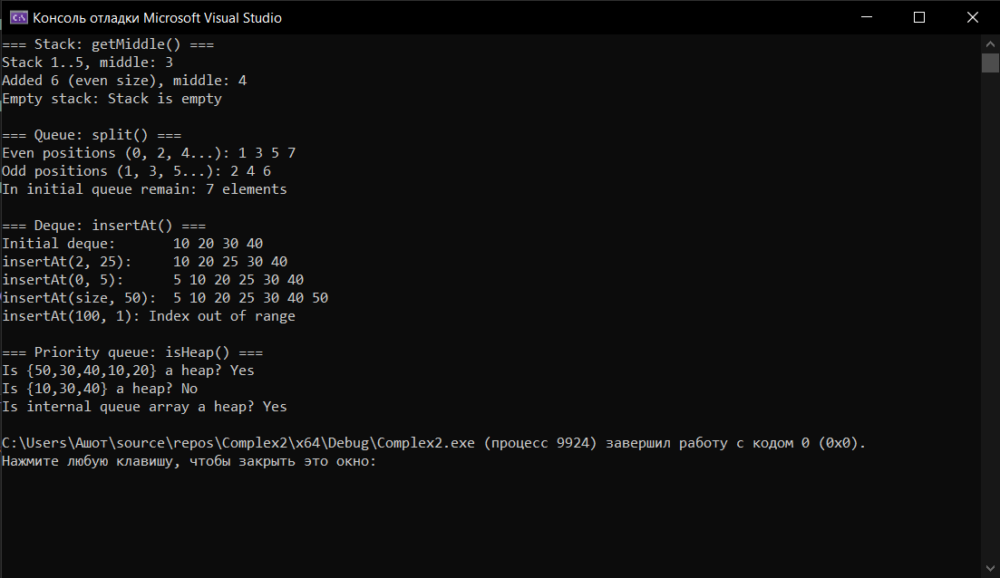

# Лабораторная работа №5: Стек, очередь, дек, приоритетная очередь
**Вариант:** 12
**Технология:** C++

## Содержание
- [Лабораторная работа №5: Стек, очередь, дек, приоритетная очередь](#лабораторная-работа-5-стек-очередь-дек-приоритетная-очередь)
  - [Содержание](#содержание)
  - [Цель работы](#цель-работы)
  - [Теоретическая часть](#теоретическая-часть)
  - [Выполнение индивидуального задания](#выполнение-индивидуального-задания)
    - [Результат работы](#результат-работы)
  - [Ответы на вопросы](#ответы-на-вопросы)
  - [Вывод](#вывод)

## Цель работы
1. Реализовать основные линейные структуры данных: стек, очередь, дек и приоритетную очередь.
2. Освоить принципы LIFO (стек) и FIFO (очередь).
3. Научиться реализовывать эти структуры на основе динамического массива и связного списка.
4. Изучить применение стека для решения задач (проверка скобок, обратная польская запись).
5. Реализовать приоритетную очередь на основе кучи (heap).

## Теоретическая часть
**Стек** - это структура данных, работающая по принципу LIFO (Last In - First Out, «последним пришёл - первым ушел»).

**Очередь** - это структура данных, работающая по принципу FIFO (First In - First Out, «первым пришёл - первым ушел»).

**Дек** - это структура данных, позволяющая добавлять и удалять элементы с обоих концов.

**Приоритетная очередь** - это структура данных, в которой каждый элемент имеет приоритет. Элемент с наибольшим приоритетом извлекается первым.
## Выполнение индивидуального задания
В рамках индивидуального задания нужно создать четыре структуры: стек с поддержкой операции getMiddle() (середина стека), очередь с возможностью её разделения на две, содержащие чётные и нечётные позиции, дек с операцией insertAt(index) и приоритетную очередь с операцией проверки, является ли массив двоичной кучей.
Код для индивидуального задания
**Structures.h**
``` cpp
#ifndef STRUCTURES_H
#define STRUCTURES_H

#include <stdexcept>

// ---------- Стек с getMiddle() ----------
template <typename T>
class Stack {
private:
	T* data;
	int count;
	int capacity;
	void grow();

public:
	explicit Stack(int initialCapacity = 10);
	~Stack();
	Stack(const Stack&) = delete;
	Stack& operator=(const Stack&) = delete;

	void push(const T& value);
	T pop();
	const T& top() const;
	// Элемент с индексом size/2, считая от дна (для чётного размера это верхний из двух средних)
	const T& getMiddle() const;
	bool isEmpty() const;
	int size() const;
};

// ---------- Очередь с разделением на чётные и нечётные позиции ----------
template <typename T>
class Queue {
private:
	T* data;
	int head;
	int count;
	int capacity;
	void grow();

public:
	explicit Queue(int initialCapacity = 10);
	~Queue();
	Queue(const Queue&) = delete;
	Queue& operator=(const Queue&) = delete;

	void push(const T& value);
	T pop();
	const T& front() const;
	void clear();
	bool isEmpty() const;
	int size() const;

	// Исходная очередь не меняется. Позиции считаются с 0:
	// в even попадают элементы на четных позициях, в odd - на нечётных.
	// Прежнее содержимое even и odd стирается.
	void split(Queue& even, Queue& odd) const;
};

// ---------- Дек с insertAt(index, value) ----------
template <typename T>
class Deque {
private:
	T* data;
	int head;
	int count;
	int capacity;
	void grow();
	int idx(int logical) const { return (head + logical) % capacity; }

public:
	explicit Deque(int initialCapacity = 10);
	~Deque();
	Deque(const Deque&) = delete;
	Deque& operator=(const Deque&) = delete;

	void pushFront(const T& value);
	void pushBack(const T& value);
	T popFront();
	T popBack();
	const T& front() const;
	const T& back() const;
	const T& at(int index) const;
	bool isEmpty() const;
	int size() const;

	// Вставляет value так, что после вставки он окажется на позиции index.
	// Допустимые индексы: 0..size() включительно, иначе std::out_of_range.
	void insertAt(int index, const T& value);
};

// ---------- Приоритетная очередь (max-heap) с проверкой кучи ----------
template <typename T>
class PriorityQueue {
private:
	T* heap;
	int count;
	int capacity;
	void grow();
	void heapifyUp(int index);
	void heapifyDown(int index);

public:
	explicit PriorityQueue(int initialCapacity = 10);
	~PriorityQueue();
	PriorityQueue(const PriorityQueue&) = delete;
	PriorityQueue& operator=(const PriorityQueue&) = delete;

	void push(const T& value);
	T pop();
	const T& top() const;
	bool isEmpty() const;
	int size() const;

	// Проверка внутреннего массива очереди
	bool isHeap() const;
	// Проверка произвольного массива: является ли он max-кучей
	static bool isHeap(const T* arr, int n);
};

#endif
```
___
**Structures.cpp**
``` cpp
#include "Structures.h"
#include <utility>

// ======================= Stack =======================
template <typename T>
Stack<T>::Stack(int initialCapacity)
	: data(nullptr), count(0), capacity(initialCapacity) {
	if (initialCapacity <= 0) throw std::invalid_argument("Capacity must be positive");
	data = new T[capacity];
}

template <typename T>
Stack<T>::~Stack() { delete[] data; }

template <typename T>
void Stack<T>::grow() {
	int newCapacity = capacity * 2;
	T* newData = new T[newCapacity];
	for (int i = 0; i < count; i++) newData[i] = data[i];
	delete[] data;
	data = newData;
	capacity = newCapacity;
}

template <typename T>
void Stack<T>::push(const T& value) {
	if (count == capacity) grow();
	data[count++] = value;
}

template <typename T>
T Stack<T>::pop() {
	if (isEmpty()) throw std::underflow_error("Stack is empty");
	return data[--count];
}

template <typename T>
const T& Stack<T>::top() const {
	if (isEmpty()) throw std::underflow_error("Stack is empty");
	return data[count - 1];
}

template <typename T>
const T& Stack<T>::getMiddle() const {
	if (isEmpty()) throw std::underflow_error("Stack is empty");
	return data[count / 2];   // O(1), так как стек хранится в массиве
}

template <typename T>
bool Stack<T>::isEmpty() const { return count == 0; }

template <typename T>
int Stack<T>::size() const { return count; }

// ======================= Queue (кольцевой буфер) =======================
template <typename T>
Queue<T>::Queue(int initialCapacity)
	: data(nullptr), head(0), count(0), capacity(initialCapacity) {
	if (initialCapacity <= 0) throw std::invalid_argument("Capacity must be positive");
	data = new T[capacity];
}

template <typename T>
Queue<T>::~Queue() { delete[] data; }

template <typename T>
void Queue<T>::grow() {
	int newCapacity = capacity * 2;
	T* newData = new T[newCapacity];
	for (int i = 0; i < count; i++) newData[i] = data[(head + i) % capacity];
	delete[] data;
	data = newData;
	head = 0;
	capacity = newCapacity;
}

template <typename T>
void Queue<T>::push(const T& value) {
	if (count == capacity) grow();
	data[(head + count) % capacity] = value;
	count++;
}

template <typename T>
T Queue<T>::pop() {
	if (isEmpty()) throw std::underflow_error("Queue is empty");
	T value = data[head];
	head = (head + 1) % capacity;
	count--;
	return value;
}

template <typename T>
const T& Queue<T>::front() const {
	if (isEmpty()) throw std::underflow_error("Queue is empty");
	return data[head];
}

template <typename T>
void Queue<T>::clear() { head = 0; count = 0; }

template <typename T>
bool Queue<T>::isEmpty() const { return count == 0; }

template <typename T>
int Queue<T>::size() const { return count; }

template <typename T>
void Queue<T>::split(Queue& even, Queue& odd) const {
	if (&even == this || &odd == this || &even == &odd)
		throw std::invalid_argument("split needs two distinct, separate queues");
	even.clear();
	odd.clear();
	for (int i = 0; i < count; i++) {
		const T& value = data[(head + i) % capacity];		// чтобы не выходило за массив
		if (i % 2 == 0) even.push(value);
		else odd.push(value);
	}
}

// ---------- Deque (кольцевой буфер) ----------
template <typename T>
Deque<T>::Deque(int initialCapacity)
	: data(nullptr), head(0), count(0), capacity(initialCapacity) {
	if (initialCapacity <= 0) throw std::invalid_argument("Capacity must be positive");
	data = new T[capacity];
}

template <typename T>
Deque<T>::~Deque() { delete[] data; }

template <typename T>
void Deque<T>::grow() {
	int newCapacity = capacity * 2;
	T* newData = new T[newCapacity];
	for (int i = 0; i < count; i++) newData[i] = data[idx(i)];
	delete[] data;
	data = newData;
	head = 0;
	capacity = newCapacity;
}

template <typename T>
void Deque<T>::pushFront(const T& value) {
	if (count == capacity) grow();
	head = (head - 1 + capacity) % capacity;
	data[head] = value;
	count++;
}

template <typename T>
void Deque<T>::pushBack(const T& value) {
	if (count == capacity) grow();
	data[idx(count)] = value;
	count++;
}

template <typename T>
T Deque<T>::popFront() {
	if (isEmpty()) throw std::underflow_error("Deque is empty");
	T value = data[head];
	head = (head + 1) % capacity;
	count--;
	return value;
}

template <typename T>
T Deque<T>::popBack() {
	if (isEmpty()) throw std::underflow_error("Deque is empty");
	count--;
	return data[idx(count)];
}

template <typename T>
const T& Deque<T>::front() const {
	if (isEmpty()) throw std::underflow_error("Deque is empty");
	return data[head];
}

template <typename T>
const T& Deque<T>::back() const {
	if (isEmpty()) throw std::underflow_error("Deque is empty");
	return data[idx(count - 1)];
}

template <typename T>
const T& Deque<T>::at(int index) const {
	if (index < 0 || index >= count) throw std::out_of_range("Index out of range");
	return data[idx(index)];
}

template <typename T>
bool Deque<T>::isEmpty() const { return count == 0; }

template <typename T>
int Deque<T>::size() const { return count; }

template <typename T>
void Deque<T>::insertAt(int index, const T& value) {
	if (index < 0 || index > count) throw std::out_of_range("Index out of range");
	if (count == capacity) grow();

	if (index < count / 2) {
		// Ближе к началу: сдвигаем элементы [0, index) на одну позицию влево
		head = (head - 1 + capacity) % capacity;
		for (int i = 0; i < index; i++)
			data[idx(i)] = data[idx(i + 1)];
	}
	else {
		// Ближе к концу: сдвигаем элементы [index, count) на одну позицию вправо
		for (int i = count; i > index; i--)
			data[idx(i)] = data[idx(i - 1)];
	}
	data[idx(index)] = value;
	count++;
}

// ======================= PriorityQueue =======================
template <typename T>
PriorityQueue<T>::PriorityQueue(int initialCapacity)
	: heap(nullptr), count(0), capacity(initialCapacity) {
	if (initialCapacity <= 0) throw std::invalid_argument("Capacity must be positive");
	heap = new T[capacity];
}

template <typename T>
PriorityQueue<T>::~PriorityQueue() { delete[] heap; }

template <typename T>
void PriorityQueue<T>::grow() {
	int newCapacity = capacity * 2;
	T* newHeap = new T[newCapacity];
	for (int i = 0; i < count; i++) newHeap[i] = heap[i];
	delete[] heap;
	heap = newHeap;
	capacity = newCapacity;
}

// heapifyUp и heapifyDown необходимы для поднятия (погружения)
// элементов по дереву.
template <typename T>
void PriorityQueue<T>::heapifyUp(int index) {
	while (index > 0) {
		int parent = (index - 1) / 2;
		if (heap[index] > heap[parent]) {
			std::swap(heap[index], heap[parent]);
			index = parent;
		}
		else break;
	}
}

template <typename T>
void PriorityQueue<T>::heapifyDown(int index) {
	while (true) {
		int left = 2 * index + 1;
		int right = 2 * index + 2;
		int largest = index;
		if (left < count && heap[left] > heap[largest]) largest = left;
		if (right < count && heap[right] > heap[largest]) largest = right;
		if (largest == index) break;
		std::swap(heap[index], heap[largest]);
		index = largest;
	}
}

template <typename T>
void PriorityQueue<T>::push(const T& value) {
	if (count == capacity) grow();
	heap[count] = value;
	heapifyUp(count);
	count++;
}

template <typename T>
T PriorityQueue<T>::pop() {
	if (isEmpty()) throw std::underflow_error("PriorityQueue is empty");
	T maxValue = heap[0];
	heap[0] = heap[count - 1];
	count--;
	heapifyDown(0);
	return maxValue;
}

template <typename T>
const T& PriorityQueue<T>::top() const {
	if (isEmpty()) throw std::underflow_error("PriorityQueue is empty");
	return heap[0];
}

template <typename T>
bool PriorityQueue<T>::isEmpty() const { return count == 0; }

template <typename T>
int PriorityQueue<T>::size() const { return count; }

template <typename T>
bool PriorityQueue<T>::isHeap() const { return isHeap(heap, count); }

template <typename T>
bool PriorityQueue<T>::isHeap(const T* arr, int n) {
	// Достаточно проверить каждый элемент относительно его родителя:
	// если ни один ребёнок не больше родителя, то свойство max-кучи выполнено.
	for (int i = 1; i < n; i++) {
		if (arr[i] > arr[(i - 1) / 2]) return false;
	}
	return true;
}

// ---------- Явные инстанцирования ----------
// Компилятор генерирует код шаблона только в момент использования с конкретным типом, 
// и для этого ему нужно видеть полное определение методов в текущем файле. 
template class Stack<int>;
template class Stack<double>;
template class Stack<char>;

template class Queue<int>;
template class Queue<double>;
template class Queue<char>;

template class Deque<int>;
template class Deque<double>;
template class Deque<char>;

template class PriorityQueue<int>;
template class PriorityQueue<double>;
template class PriorityQueue<char>;
```
___
**main.cpp**
``` cpp
#include <iostream>
#include "Structures.h"

void demoStack() {
	std::cout << "=== Stack: getMiddle() ===\n";
	Stack<int> s;
	for (int i = 1; i <= 5; i++) s.push(i);
	std::cout << "Stack 1..5, middle: " << s.getMiddle() << "\n";   // 3
	s.push(6);
	std::cout << "Added 6 (even size), middle: " << s.getMiddle() << "\n";   // 4

	Stack<int> empty;
	try { empty.getMiddle(); }
	catch (const std::underflow_error& e) {
		std::cout << "Empty stack: " << e.what() << "\n";
	}
}

void demoQueue() {
	std::cout << "\n=== Queue: split() ===\n";
	Queue<int> q;
	for (int i = 1; i <= 7; i++) q.push(i);

	Queue<int> even, odd;
	q.split(even, odd);

	std::cout << "Even positions (0, 2, 4...): ";
	while (!even.isEmpty()) std::cout << even.pop() << " ";    // 1 3 5 7
	std::cout << "\nOdd positions (1, 3, 5...): ";
	while (!odd.isEmpty()) std::cout << odd.pop() << " ";      // 2 4 6
	std::cout << "\nIn initial queue remain: " << q.size() << " elements\n";
}

template <typename T>
void printDeque(const Deque<T>& d) {
	for (int i = 0; i < d.size(); i++) std::cout << d.at(i) << " ";
	std::cout << "\n";
}

void demoDeque() {
	std::cout << "\n=== Deque: insertAt() ===\n";
	Deque<int> d;
	for (int v : {10, 20, 30, 40}) d.pushBack(v);
	std::cout << "Initial deque:       "; printDeque(d);

	d.insertAt(2, 25);
	std::cout << "insertAt(2, 25):     "; printDeque(d);   // 10 20 25 30 40

	d.insertAt(0, 5);
	std::cout << "insertAt(0, 5):      "; printDeque(d);   // 5 10 20 25 30 40

	d.insertAt(d.size(), 50);
	std::cout << "insertAt(size, 50):  "; printDeque(d);   // ... 40 50

	try { d.insertAt(100, 1); }
	catch (const std::out_of_range& e) {
		std::cout << "insertAt(100, 1): " << e.what() << "\n";
	}
}

void demoPriorityQueue() {
	std::cout << "\n=== Priority queue: isHeap() ===\n";
	int good[] = { 50, 30, 40, 10, 20 };
	int bad[] = { 10, 30, 40 };
	std::cout << "Is {50,30,40,10,20} a heap? "
		<< (PriorityQueue<int>::isHeap(good, 5) ? "Yes" : "No") << "\n";
	std::cout << "Is {10,30,40} a heap? "
		<< (PriorityQueue<int>::isHeap(bad, 3) ? "Yes" : "No") << "\n";

	PriorityQueue<int> pq;
	for (int v : {30, 10, 50, 20, 40}) pq.push(v);
	std::cout << "Is internal queue array a heap? "
		<< (pq.isHeap() ? "Yes" : "No") << "\n";
}

int main() {
	demoStack();
	demoQueue();
	demoDeque();
	demoPriorityQueue();
	return 0;
}
```
___
### Результат работы

*Результат работы программы*

## Ответы на вопросы
1. В чём заключается принцип работы стека (LIFO)?
Стек работает по принципу LIFO (Last In, First Out) — последним добавлен, первым удалён. Основные операции: push() — добавление элемента, pop() — удаление верхнего элемента.
2. В чём заключается принцип работы очереди (FIFO)?
Очередь работает по принципу FIFO (First In, First Out) — первым добавлен, первым удалён. enqueue() добавляет элемент в конец очереди, а dequeue() удаляет элемент из начала.
3. Чем дек отличается от обычной очереди?
Дек (deque) позволяет добавлять и удалять элементы с обоих концов. Обычная очередь добавляет элементы в конец, а удаляет из начала.
4. Что такое приоритетная очередь? Где она применяется?
Приоритетная очередь — структура данных, в которой элементы извлекаются по приоритету, а не по порядку добавления. Применяется в алгоритмах Дейкстры, планировании задач и обработке событий. В C++ реализуется с помощью std::priority_queue.
5. Как реализовать стек на основе динамического массива?
Использовать std::vector: добавлять элементы через push_back(), удалять через pop_back(), получать верхний элемент через back(). При необходимости массив автоматически увеличивает вместимость.
6. Как реализовать очередь на основе кольцевого буфера?
Использовать массив фиксированного размера и индексы начала (front) и конца (rear). После добавления или удаления индексы сдвигаются по кругу с помощью остатка от деления на размер буфера. Операции enqueue() и dequeue() выполняются за (O(1)).
7. Почему приоритетную очередь обычно реализуют на куче?
Куча позволяет быстро получать элемент с максимальным или минимальным приоритетом за (O(1)), добавлять элемент за (O(log n)) и удалять корневой элемент за (O(log n)). Поэтому она эффективна для приоритетных очередей.
8. Какова сложность операций push и pop в стеке?
Обе операции обычно выполняются за (O(1)). При использовании динамического массива push() иногда требует (O(n)) из-за расширения массива, но амортизированная сложность составляет (O(1)).
9. Какова сложность операций enqueue и dequeue в очереди?
При реализации на связном списке или кольцевом буфере обе операции выполняются за (O(1)). При реализации на обычном массиве с удалением первого элемента dequeue() может иметь сложность (O(n)).
10. Какова сложность операций в приоритетной очереди? Почему?
При реализации на бинарной куче:
- Получение максимального или минимального элемента — (O(1)).
- Добавление элемента — (O(log n)).
- Удаление элемента с наивысшим приоритетом — (O(log n)).
Это связано с тем, что куча является почти полным бинарным деревом, высота которого составляет (O(log n)).
11. Как проверить правильность расстановки скобок с помощью стека?
При встрече открывающей скобки помещать её в стек. При встрече закрывающей проверять, соответствует ли она последней открывающей скобке, и удалять её из стека. Если соответствия нет или в конце стек не пуст, расстановка неправильная. Сложность — (O(n)).
12. Как реализовать очередь на двух стеках? Какова сложность?
Использовать стек input для добавления элементов и стек output для удаления. Если output пуст, переносить в него все элементы из input. Тогда верхний элемент output будет первым элементом очереди. Амортизированная сложность enqueue() и dequeue() — (O(1)), в худшем случае отдельная операция может занимать (O(n)).
13. Как реализовать дек на основе двусвязного списка?
Использовать std::list или собственный двусвязный список с указателями на начало и конец. Добавлять элементы через push_front() и push_back(), удалять через pop_front() и pop_back(). Все эти операции выполняются за (O(1)).
14. Как реализовать дек на основе кольцевого буфера?
Использовать массив фиксированного размера и индексы начала и конца. При добавлении и удалении с обоих концов индексы перемещаются циклически по формуле с остатком от деления на размер массива. Все основные операции выполняются за (O(1)), если буфер не требует расширения.
15. Как реализовать стек с поддержкой получения минимума за O(1)?
Хранить два стека: основной и стек минимумов. При добавлении элемента в основной стек также добавлять его в стек минимумов, если он меньше или равен текущему минимуму. При удалении минимального элемента удалять его и из стека минимумов. Текущий минимум доступен на вершине второго стека за (O(1)).

## Вывод 
В ходе выполнения лабораторной работы были получены навыки реализации основные линейные структуры данных (стека, очереди, дека и приоритетной очереди) на основе динамического массива и связного списка и приоритетной очереди на основе кучи (heap), освоены принципы LIFO (стек) и FIFO (очередь), изучено применение стека для решения задач (проверка скобок, обратная польская запись). 