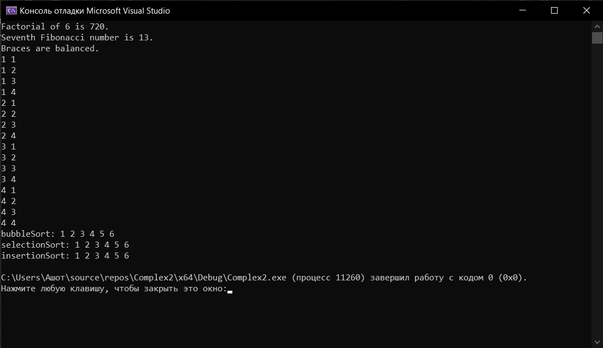

# Лабораторная работа №6: Рекурсивные алгоритмы. Простые сортировки 
**Вариант:** 12
**Технология:** C++

## Содержание
- [Лабораторная работа №6: Рекурсивные алгоритмы. Простые сортировки](#лабораторная-работа-6-рекурсивные-алгоритмы-простые-сортировки)
	- [Содержание](#содержание)
	- [Цель работы](#цель-работы)
	- [Теоретическая часть](#теоретическая-часть)
	- [Выполнение индивидуального задания](#выполнение-индивидуального-задания)
		- [Результат работы](#результат-работы)
	- [Ответы на вопросы](#ответы-на-вопросы)
	- [Вывод](#вывод)

## Цель работы
1. Освоить принципы рекурсии: прямой и косвенной, базовый случай и шаг рекурсии.
2. Научиться применять рекурсию для решения практических задач (факториал, числа Фибоначчи, Ханойские башни, обход лабиринта). 
3. Реализовать и сравнить простые алгоритмы сортировки: пузырьковую, вставками, выбором.
4. Проанализировать сложность рекурсивных алгоритмов и простых сортировок.
5. Сравнить рекурсивную и итеративную реализации одних и тех же алгоритмов.

## Теоретическая часть
**Рекурсия** - это метод программирования, при котором функция вызывает саму себя для решения подзадач меньшего размера.

## Выполнение индивидуального задания
В рамках индивидуального задания необходимо с помощью рекурсию реализовать функции для нахождения факториалов, чисел Фиббоначи, проверки сбалансированности скобок и генерации комбинаций чисел, а также реализовать сортировки пузырьком, вставкой и выбором (сортировку вставкой реализовать рекурсивно). 
Код для индивидуального задания
``` cpp
#include <iostream>
using namespace std;

// Факториал числа n
int factorial(int n) {
	if (n <= 1) return 1;
	return n * factorial(n - 1);    
}

// n-ое число Фиббоначи 
int fibonacci(int n) {
	if (n <= 1) return n;
	return fibonacci(n - 1) + fibonacci(n - 2);
}

// Рекурсивная проверка сбалансированности скобок
bool checkBraces(char braces[], int n, int index, int balance) {
	if (index == n) 
		return balance == 0;

	if (braces[index] == '(')
		balance++;
	else if (braces[index] == ')')
		balance--;

	if (balance < 0) return false;

	return checkBraces(braces, n, index + 1, balance);
}

// Рекурсивная генерация всех комбинаций
void generate(int numbers[], int n,
	int result[], int k, int index) {

	// Базовый случай: комбинация заполнена
	if (index == k) {
		for (int i = 0; i < k; i++) {
			cout << result[i] << " ";
		}
		cout << '\n';
		return;
	}

	for (int i = 0; i < n; i++) {
		result[index] = numbers[i];
		// Переход к следующей позиции
		generate(numbers, n, result, k, index + 1);
	}
}

// Сортировка пузырьком
void bubbleSort(int arr[], int n) {
	for (int i = 0; i < n - 1; i++) {
		bool swapped = false;
		for (int j = 0; j < n - i - 1; j++) {
			if (arr[j] > arr[j + 1]) {
				swap(arr[j], arr[j + 1]);
				swapped = true;
			}
		}
		if (!swapped) break;
	}

	cout << "bubbleSort: ";
	for (int i = 0; i < n; ++i)
		cout << arr[i] << ' ';
	cout << '\n';
}

// Рекурсивная сортировка вставкой
void insertionSort(int arr[], int n) {
	// Базовый случай
	if (n <= 1) {

		for (int i = 0; i < n; ++i)
		return;
	}

	insertionSort(arr, n - 1);

	// Сохранение последний элемент
	int key = arr[n - 1];

	// Поиск места для вставки
	int j = n - 2;

	while (j >= 0 && arr[j] > key) {
		arr[j + 1] = arr[j];
		j--;
	}

	// Вставка элемента на правильное место
	arr[j + 1] = key;
}

// Сортировка выбором
void selectionSort(int arr[], int n) {
	for (int i = 0; i < n - 1; i++) {
		int minIndex = i;
		for (int j = i + 1; j < n; j++) {
			if (arr[j] < arr[minIndex]) {
				minIndex = j;
			}
		}
		if (minIndex != i) swap(arr[i], arr[minIndex]);
	}

	cout << "selectionSort: ";
	for (int i = 0; i < n; ++i)
		cout << arr[i] << ' ';
	cout << '\n';
}

int main() {
	cout << "Factorial of 6 is " << factorial(6) << ".\n";
	cout << "Seventh Fibonacci number is " << fibonacci(7) << ".\n";

	char braces[] = { '(', '(', ')', '(', ')', ')' };
	int bracesAmount = sizeof(braces) / sizeof(braces[0]);

	cout << (checkBraces(braces, bracesAmount, 0, 0)
		? "Braces are balanced."
		: "Braces aren't balanced.") << '\n';
	
	int combinators[] = { 1, 2, 3, 4 };
	const int K = 2;
	int result[K];
	int combinatorsAmount = sizeof(combinators) / sizeof(combinators[0]);
	generate(combinators, combinatorsAmount, result, K, 0);

	int numbers[] = { 2, 5, 4, 3, 1, 6 };
	const int N = sizeof(numbers) / sizeof(numbers[0]);

	int bubble[N];
	int insertion[N];
	int selection[N];

	// Копирование исходный массив (чтобы исходный не изменялся)
	for (int i = 0; i < N; i++) {
		bubble[i] = numbers[i];
		insertion[i] = numbers[i];
		selection[i] = numbers[i];
	}

	bubbleSort(bubble, N);
	insertionSort(insertion, N);
	selectionSort(selection, N);

	// Вывод результата insertionSort
	cout << "insertionSort: ";
	for (int i = 0; i < N; i++) {
		cout << insertion[i] << ' ';
	}
	cout << '\n';
		
	return 0;
}
```

___
### Результат работы

*Результат работы программы*

## Ответы на вопросы
1. Что такое рекурсия? Из каких компонентов состоит рекурсивная функция?
Рекурсия - это способ решения задачи, при котором функция вызывает сама себя для решения более простой версии исходной задачи.
Рекурсивная функция состоит из двух основных компонентов: базовый случай - условие, при котором рекурсия прекращается, - и рекурсивный вызов - вызов функции с изменёнными параметрами, приближающими выполнение к базовому случаю.
2. Что такое базовый случай рекурсии? Почему он важен?
Базовый случай - это условие, при котором функция перестаёт вызывать саму себя и возвращает результат.
Он необходим для остановки рекурсии. Без него функция будет бесконечно вызывать саму себя, что может привести к переполнению стека вызовов.
3. Чем отличается прямая рекурсия от косвенной?
Прямая рекурсия - функция вызывает саму себя непосредственно.
Косвенная рекурсия - одна функция вызывает другую, которая в итоге вызывает первую.
4. Что такое хвостовая рекурсия? В чём её преимущество?
Хвостовая рекурсия - это вид рекурсии, при котором рекурсивный вызов является последней операцией функции.
Преимущество заключается в возможности оптимизации компилятором: в некоторых языках и компиляторах стек вызовов может не увеличиваться при каждом вызове.
5. Какова временная сложность рекурсивного вычисления чисел Фибоначчи? Почему?
Временная сложность наивного рекурсивного алгоритма составляет (O(2^n)).
Причина - многократное повторное вычисление одних и тех же чисел.
6. Как можно оптимизировать рекурсивное вычисление Фибоначчи?
Можно использовать сохранение уже вычисленных результатов, чтобы не вычислять их повторно, что позволяет снизить сложность до (O(n)).
7. В чём отличие рекурсивной реализации от итеративной?
Рекурсивная реализация использует вызовы функции самой себя. Она часто делает код более понятным для задач с вложенной структурой, но требует дополнительной памяти для стека вызовов.
Итеративная реализация использует циклы (for, while). Итерация обычно экономнее по памяти и не имеет риска переполнения стека из-за большого количества вызовов.
8. Какова сложность пузырьковой сортировки? Когда она становится O(n)?
Лучший случай - (O(n)).
Средний случай - (O(n^2)).
Худший случай - (O(n^2)).
Сложность становится (O(n)), когда массив уже отсортирован и используется оптимизация с флагом swapped, позволяющим завершить сортировку при отсутствии обменов.
9. Чем сортировка вставками отличается от сортировки выбором?
Сортировка вставками берёт очередной элемент и вставляет его на правильное место в уже отсортированной части массива.
Сортировка выбором каждый раз ищет минимальный элемент в неотсортированной части массива и перемещает его в начало этой части.
Обе имеют сложность (O(n^2)) в среднем и худшем случае.
10. Какая из простых сортировок является устойчивой? Что это значит?
Устойчивые сортировки сохраняют относительный порядок элементов с одинаковыми ключами.
Из рассматриваемых алгоритмов:
- Пузырьковая сортировка - устойчивая.
- Сортировка вставками - устойчивая.
- Сортировка выбором - в стандартной реализации неустойчивая.
Например, если два объекта имеют одинаковое значение, устойчивая сортировка сохранит их первоначальный порядок.
11. Какая из простых сортировок работает лучше на почти отсортированных данных?
Сортировка вставками, так как она требует минимального количества перемещений, если массив уже почти отсортирован.
12. Как реализовать пузырьковую сортировку с оптимизацией?
Нужно использовать логическуюпеременную swapped, которая показывает, были ли обмены во время текущего прохода.
Если обменов не было, значит, массив уже отсортирован и дальнейшие проходы не нужны.
13. Что такое рекурсивный поиск с возвратом (backtracking)?
Backtracking (поиск с возвратом) - это метод решения задач, при котором алгоритм перебирает возможные варианты решения с помощью рекурсии.
Если выбранный вариант не приводит к решению, алгоритм возвращается к предыдущему состоянию и пробует другой вариант.
14. Как рекурсивно обойти лабиринт?
Алгоритм работает следующим образом:
- Проверка, является ли текущая клетка выходом.
- Проверяа, можно ли перейти в текущую клетку (она должна быть свободной и ещё не посещённой).
- Пометка клетки как посещённой.
- Рекурсивная проверяка четыре направления: вверх, вниз, влево и вправо.
- Если путь не найден, возвращение назад и выбор другого направление.
Таким образом, алгоритм перебирает возможные пути, пока не найдёт выход или не проверит все варианты.
15.  Какова сложность Ханойских башен? Сколько ходов нужно для перемещения n дисков?
Для решения задачи Ханойских башен используется рекурсия.
Алгоритм: перемещаем n - 1 дисков на вспомогательный стержень; перемещаем самый большой диск на целевой стержень; перемещаем n - 1 дисков со вспомогательного стержня на целевой.
Минимальное количество ходов - 2^n - 1.

## Вывод 
В ходе выполнения лабораторной работы были освоены принципы рекурсии (прямой и косвенной, базовый случай и шаг рекурсии), получены навыки применения рекурсия для решения практических задач, реализованы и сравнены простые алгоритмы сортировки, проанализированы сложности рекурсивных алгоритмов и простых сортировок, изучены рекурсивная и итеративная реализации одних и тех же алгоритмов.