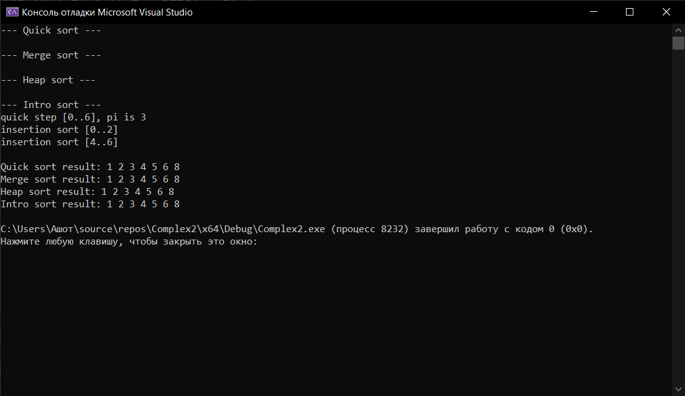

# Лабораторная работа №7: Быстрая сортировка, сортировка слиянием, пирамидальная сортировка 
**Вариант:** 6
**Технология:** C++

## Содержание
- [Лабораторная работа №7: Быстрая сортировка, сортировка слиянием, пирамидальная сортировка](#лабораторная-работа-7-быстрая-сортировка-сортировка-слиянием-пирамидальная-сортировка)
	- [Содержание](#содержание)
	- [Цель работы](#цель-работы)
	- [Теоретическая часть](#теоретическая-часть)
	- [Выполнение индивидуального задания](#выполнение-индивидуального-задания)
		- [Результат работы](#результат-работы)
	- [Ответы на вопросы](#ответы-на-вопросы)
	- [Вывод](#вывод)

## Цель работы
1. Реализовать три эффективных алгоритма сортировки: быструю сортировку (Quick Sort), сортировку слиянием (Merge Sort) и пирамидальную сортировку (Heap Sort).
2. Освоить принципы «разделяй и властвуй» на примере быстрой сортировки и сортировки слиянием.
3. Изучить структуру данных «куча» (heap) для реализации пирамидальной сортировки.
4. Проанализировать и сравнить производительность различных алгоритмов сортировки.
5. Понять преимущества и недостатки каждого алгоритма в различных сценариях использования.

## Теоретическая часть
**Принцип работы быстрой сортировки ("разделяй и властвуй")**: выбрать опорный элемент (pivot), разделить массив (элементы меньше pivot - слева, больше - справа), рекурсивно применить к левой и правой частям.

**Принцип работы сортировки слиянием**: разделить массив пополам, рекурсивно отсортировать каждую половину, после слить две отсортированные половины.

**Принцип работы пирамидальной сортировки**: построить двоичную кучу (max-heap) из массива,извлекать корень (максимальный элемент) и помещать в конец массива, восстанавливать свойство кучи.
## Выполнение индивидуального задания
В рамках индивидуального задания необходимо реализовать все три сортировки с полной функциональностью и провести углублённый анализ. Сортировка слиянием должна уметь работать с распределёнными системами.

Код для индивидуального задания
``` cpp
#include <iostream>
#include <cmath>

using namespace std;

// ---------- Быстрая сортировка ----------
int partition(int arr[], int low, int high) {
	int pivot = arr[high];  // Опорный элемент (последний) 
	int i = low - 1;

	// Индекс для меньших элементов 
	for (int j = low; j < high; j++) {
		if (arr[j] <= pivot) {
			i++;
			swap(arr[i], arr[j]);
		}
	}

	swap(arr[i + 1], arr[high]);

	return i + 1;  // Позиция опорного элемента 
}

void quickSort(int arr[], int low, int high) {
	if (low < high) {
		int pi = partition(arr, low, high);
		quickSort(arr, low, pi - 1);
		quickSort(arr, pi + 1, high);
	}
}

// ---------- Сортировка слиянием ----------
void merge(int arr[], int left, int mid, int right) {
	int n1 = mid - left + 1;
	int n2 = right - mid;

	int* L = new int[n1];
	int* R = new int[n2];

	for (int i = 0; i < n1; i++) L[i] = arr[left + i];
	for (int j = 0; j < n2; j++) R[j] = arr[mid + 1 + j];

	int i = 0, j = 0, k = left;
	while (i < n1 && j < n2) {
		if (L[i] <= R[j]) arr[k++] = L[i++];
		else arr[k++] = R[j++];
	}

	while (i < n1) arr[k++] = L[i++];
	while (j < n2) arr[k++] = R[j++];

	delete[] L;
	delete[] R;
}

void mergeSort(int arr[], int left, int right) {
	if (left < right) {
		int mid = left + (right - left) / 2;
		mergeSort(arr, left, mid);
		mergeSort(arr, mid + 1, right);
		merge(arr, left, mid, right);
	}
}

// Пирамидальная сортировка 
void heapify(int arr[], int n, int i) {
	int largest = i;
	int left = 2 * i + 1;
	int right = 2 * i + 2;

	if (left < n && arr[left] > arr[largest])
		largest = left;
	if (right < n && arr[right] > arr[largest])
		largest = right;
	if (largest != i) {
		swap(arr[i], arr[largest]);
		heapify(arr, n, largest);
	}
}
void heapSort(int arr[], int n) {
	// Построение кучи 
	for (int i = n / 2 - 1; i >= 0; i--)
		heapify(arr, n, i);
	// Извлечение элементов 
	for (int i = n - 1; i > 0; i--) {
		swap(arr[0], arr[i]);
		heapify(arr, i, 0);
	}
}

// ---------- Интроспективная сортировка ----------

// Для коротких отрезков быстрее всего работает сортировка вставками.
// В реальных реализациях порог обычно 16; здесь взят 3, чтобы на
// маленьком массиве из 7 элементов было видно работу остальных частей.
const int INSERTION_THRESHOLD = 3;

// Сортировка вставками для отрезка arr[low..high]
void insertionSort(int arr[], int low, int high) {
	for (int i = low + 1; i <= high; i++) {
		int key = arr[i];
		int j = i - 1;
		while (j >= low && arr[j] > key) {
			arr[j + 1] = arr[j];
			j--;
		}
		arr[j + 1] = key;
	}
}

// Разбиение как в быстрой сортировке, но без отладочного вывода
int partitionIntro(int arr[], int low, int high) {
	int pivot = arr[high];
	int i = low - 1;

	for (int j = low; j < high; j++) {
		if (arr[j] <= pivot) {
			i++;
			swap(arr[i], arr[j]);
		}
	}
	swap(arr[i + 1], arr[high]);
	return i + 1;
}

// Рекурсивная часть. depthLimit - сколько уровней рекурсии ещё разрешено
void introSortUtil(int arr[], int low, int high, int depthLimit) {
	int size = high - low + 1;

	// 1) Отрезок маленький - сортировка вставками.
	if (size <= INSERTION_THRESHOLD) {
		cout << "insertion sort [" << low << ".." << high << "]\n";
		insertionSort(arr, low, high);
		return;
	}

	// 2) Рекурсия слишком глубокая (плохой случай для quickSort) -
	//    переключение на пирамидальную сортировку.
	//    arr + low - указатель на начало отрезка, поэтому
	//    существующий heapSort работает с ним как с отдельным массивом.
	if (depthLimit == 0) {
		cout << "depth limit reached, heap sort [" << low << ".." << high << "]\n";
		heapSort(arr + low, size);
		return;
	}

	// 3) Обычный шаг быстрой сортировки.
	int pi = partitionIntro(arr, low, high);
	cout << "quick step [" << low << ".." << high << "], pi is " << pi << '\n';
	introSortUtil(arr, low, pi - 1, depthLimit - 1);
	introSortUtil(arr, pi + 1, high, depthLimit - 1);
}

// Обёртка: вычисляет лимит глубины и запускает сортировку
void introSort(int arr[], int n) {
	if (n < 2) return;
	int depthLimit = 2 * static_cast<int>(log2(n));  // классический лимит: 2*log2(n)
	introSortUtil(arr, 0, n - 1, depthLimit);
}

int main() {
	int arr[] = { 2, 5, 1, 3, 8, 6, 4 };

	const int size = sizeof(arr) / sizeof(arr[0]);

	int quick[size];
	int merge[size];
	int heap[size];
	int intro[size];

	for (int i{ 0 }; i < size; ++i) {
		quick[i] = arr[i];
		merge[i] = arr[i];
		heap[i] = arr[i];
		intro[i] = arr[i];
	}

	cout << "--- Quick sort ---\n";
	quickSort(quick, 0, size - 1);

	cout << "\n--- Merge sort ---\n";
	mergeSort(merge, 0, size - 1);

	cout << "\n--- Heap sort ---\n";
	heapSort(heap, size);

	cout << "\n--- Intro sort ---\n";
	introSort(intro, size);


	cout << "\nQuick sort result: ";
	for (int i{ 0 }; i < size; ++i) {
		cout << quick[i] << ' ';
	}

	cout << "\nMerge sort result: ";
	for (int i{ 0 }; i < size; ++i) {
		cout << merge[i] << ' ';
	}

	cout << "\nHeap sort result: ";
	for (int i{ 0 }; i < size; ++i) {
		cout << heap[i] << ' ';
	}

	cout << "\nIntro sort result: ";
	for (int i{ 0 }; i < size; ++i) {
		cout << intro[i] << ' ';
	}
	cout << '\n';

	return 0;
}
```

___
### Результат работы

*Результат работы программы*

## Ответы на вопросы
1. Какова сложность быстрой сортировки в лучшем, среднем и худшем случае?
Лучший случай - O(n log n), средний - O(n log n), худший - O(n^2).
2. Когда возникает худший случай для быстрой сортировки?
Когда опорный элемент каждый раз оказывается минимальным или максимальным, из-за чего массив делится на части размером 0 и n − 1.
3. Как можно улучшить быструю сортировку для защиты от худшего случая?
Выбирать случайный опорный элемент, использовать метод медианы трёх элементов или переключаться на другой алгоритм при слишком глубокой рекурсии.
4. Какова сложность сортировки слиянием? Почему она всегда O(n log n)?
Во всех случаях - O(n log n). Массив всегда делится примерно пополам, образуя log n уровней, а на каждом уровне выполняется O(n) операций слияния.
5. Какие преимущества и недостатки имеет сортировка слиянием перед быстрой?
Преимущества: гарантированная сложность O(n log n), стабильность сортировки. Недостатки: требует дополнительную память O(n) и часто работает медленнее быстрой сортировки на практике.
6. Как работает пирамидальная сортировка? Какова её сложность?
Сначала строится двоичная куча, затем максимальный элемент перемещается в конец массива. Куча перестраивается, и процесс повторяется. Сложность во всех случаях - O(n log n).
7. Какая из трёх сортировок устойчивая? Почему?
Сортировка слиянием. Она сохраняет относительный порядок равных элементов, если при слиянии выбирать первым элемент из левой части при равенстве.
8. Какая из трёх сортировок требует дополнительной памяти? Сколько?
Сортировка слиянием требует O(n) дополнительной памяти. Быстрая сортировка обычно требует O(log n) памяти на стек рекурсии в среднем, а в худшем случае - O(n). Пирамидальная сортировка работает за O(1) дополнительной памяти.
9. Какая из трёх сортировок лучше работает на почти отсортированных данных?
Это зависит от реализации и выбора опорного элемента. Сортировка слиянием сохраняет O(n log n), быстрая может работать за O(n^2), а пирамидальная - за O(n log n). Для почти отсортированных данных также хорошо подходят адаптивные алгоритмы.
10. Зачем в пирамидальной сортировке сначала строится куча?
Чтобы быстро получать максимальный элемент за O(1) и каждый раз перемещать его в конец массива, поддерживая структуру кучи.
11. Что такое «разделяй и властвуй»? Как он применяется в быстрой сортировке и сортировке слиянием?
Это принцип решения задачи путём разделения её на более мелкие подзадачи. В быстрой сортировке массив разделяется относительно опорного элемента, а в сортировке слиянием - на две половины, которые затем сортируются и объединяются.
12. Можно ли реализовать быструю сортировку итеративно (без рекурсии)?
Да. Для этого вместо рекурсивных вызовов используется собственный стек, в котором хранятся границы обрабатываемых частей массива.
13. Почему быстрая сортировка обычно быстрее сортировки слиянием на практике?
Она обычно выполняет меньше дополнительных операций с памятью, работает непосредственно внутри массива и лучше использует кэш процессора.
14. Когда выгодно использовать пирамидальную сортировку?
Когда важны гарантированная сложность O(n log n), отсутствие дополнительной памяти и предсказуемое время выполнения независимо от исходного порядка элементов.
15. Какой алгоритм сортировки вы бы выбрали для встроенных систем с ограниченной памятью?
Пирамидальную сортировку, поскольку она требует O(1) дополнительной памяти и гарантирует сложность O(n log n) в любом случае.

## Вывод 
В ходе выполнения лабораторной работы были реализованы три алгоритма сортировки (быстрая, слиянием, пирамидальная), освоены принципы «разделяй и властвуй» на примере быстрой сортировки и сортировки слиянием, изучена структура данных «куча» для реализации пирамидальной сортировки и аспекты каждого алгоритма в различных сценариях использования, проанализированы и сравнена производительность различных алгоритмов сортировки.