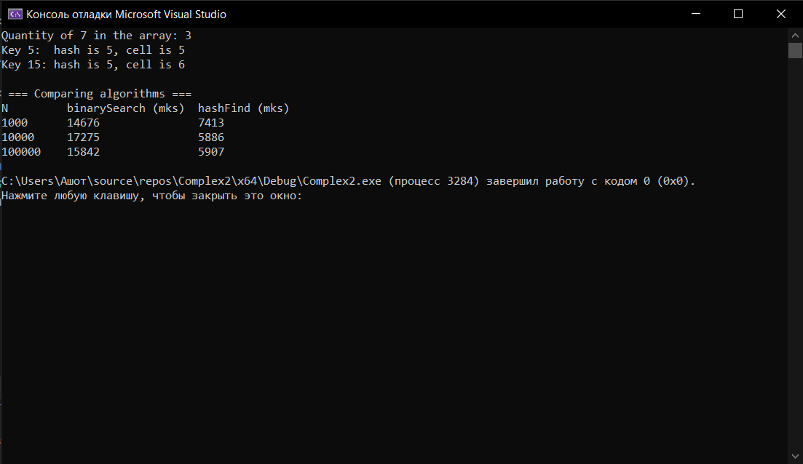

# Лабораторная работа №8: Двоичный поиск. Хеш-таблицы
**Вариант:** 12  
**Технология:** C++  

## Содержание
- [Лабораторная работа №8: Двоичный поиск. Хеш-таблицы](#лабораторная-работа-8-двоичный-поиск-хеш-таблицы)
	- [Содержание](#содержание)
	- [Цель работы](#цель-работы)
	- [Теоретическая часть](#теоретическая-часть)
	- [Выполнение индивидуального задания](#выполнение-индивидуального-задания)
		- [Результат работы](#результат-работы)
	- [Ответы на вопросы](#ответы-на-вопросы)
	- [Вывод](#вывод)

## Цель работы
1. Реализовать алгоритм двоичного (бинарного) поиска в отсортированном массиве.
2. Освоить итеративную и рекурсивную реализации двоичного поиска.
3. Изучить понятие хеш-таблицы, хеш-функции и методы разрешения коллизий.
4. Реализовать хеш-таблицу с методом цепочек и открытой адресацией.
5. Сравнить производительность двоичного поиска и хеш-таблицы.

## Теоретическая часть
**Двоичный поиск** - это алгоритм поиска элемента в отсортированном массиве, который на каждом шаге делит интервал поиска пополам. Принцип работы: нахождение среднего элемента интервала поиска, сравнение с искомым значением (если равно, возвращатся индекс; если больше, продолжается поиск в левой половине; если меньше, продолжается поиск в правой половине).  

**Хеш-таблица** - это структура данных, реализующая ассоциативный массив (словарь) и поддерживающая операции вставки, удаления и поиска в среднем за O(1). Основные компоненты: хеш-функция (преобразует ключ в индекс массива), бакет (элемент массива), хранящий данные, коллизия (ситуация, когда разные ключи дают одинаковый индекс).  

**Требования к хеш-функции**: детерминированность (один ключ → один хеш), равномерное распределение, быстрое вычисление.  

**Метод цепочек** (Chaining): при коллизии элементы с одинаковым хешем хранятся в связном списке.  

**Открытая адресация** (Open Addressing): при коллизии ищется следующий свободный бакет.  

## Выполнение индивидуального задания
В рамках индивидуального задания необходимо реализовать двоичный поиск с подсчётом количества вхождений, хеш-таблицу с линейным пробированием, а также сравнить производительность операций поиска для N = 1000, 10000, 100000 элементов и вывести таблицу зависимости времени от N.  

Код для индивидуального задания
``` cpp
#include <iostream>
#include <string>
#include <vector>
#include <chrono>
#include <algorithm>
#include <unordered_map>
#include <iomanip>

using namespace std;
using namespace chrono;

// Бинарный поиск (итеративная реализация)
int binarySearch(const int arr[], int n, int target) {
    int left = 0, right = n - 1;
    while (left <= right) {
        int mid = left + (right - left) / 2; // (left + right) / 2
        if (arr[mid] == target) return mid;
        if (arr[mid] < target) left = mid + 1;
        else right = mid - 1;
    }
    return -1;
}

// Количество вхождений элемента в массив
int binaryEntry(const int arr[], int n, int target) {
    int left = 0, right = n - 1;

    while (left <= right) {
        int mid = left + (right - left) / 2;

        if (arr[mid] == target) {
            int count = 1;
            int i = mid + 1;
            while (i < n && arr[i] == target) {
                ++count;
                ++i;
            }

            i = mid - 1;
            while (i >= 0 && arr[i] == target) {
                ++count;
                --i;
            }
            return count;
        }

        if (arr[mid] < target)
            left = mid + 1;
        else
            right = mid - 1;
    }
    return 0;
}

// Хеш-таблица с линейным пробированием
template <typename K, typename V>
class HashTableOpenAddressing {
private:
    struct Entry {
        K key;
        V value;
        bool occupied;
        Entry() : occupied(false) {}
    };

    vector<Entry> table;
    int size;

    int hash(const K& key) const {
        return key % size;
    }

public:
    HashTableOpenAddressing(int s) : table(s), size(s) {}

    void insert(const K& key, const V& value) {
        int index = hash(key);
        int i = 0;

        while (i < size && table[(index + i) % size].occupied) {
            if (table[(index + i) % size].key == key) break;
            i++;
        }

        int pos = (index + i) % size;

        table[pos].key = key;
        table[pos].value = value;
        table[pos].occupied = true;
    }

    int findIndex(const K& key) const {
        int index = hash(key);

        for (int i = 0; i < size; i++) {
            int pos = (index + i) % size;
            if (!table[pos].occupied) return -1;
            if (table[pos].key == key) return pos;
        }
        return -1;
    }

    V* find(const K& key) {
        int pos = findIndex(key);
        return pos == -1 ? nullptr : &table[pos].value;
    }

    int getHash(const K& key) const { return hash(key); }
};

struct Result {
    long long binaryTime;
    long long hashTime;
};

Result compareAlgorithms(const int N) {
    vector<int> example(N);
    unordered_map<int, int> hashMap;

    for (int i = 0; i < N; i++) {
        example[i] = i;
        hashMap[i] = i;
    }

    vector<int> queries;
    for (int i = 0; i < 10000; i++) queries.push_back(rand() % N);

    auto start = high_resolution_clock::now();
    for (int q : queries) {
        binary_search(example.begin(), example.end(), q);
    }

    auto end = high_resolution_clock::now();
    long long binaryTime = duration_cast<microseconds>(end - start).count();

    start = high_resolution_clock::now();
    for (int q : queries) {
        hashMap.find(q);
    }

    end = high_resolution_clock::now();
    long long hashTime = duration_cast<microseconds>(end - start).count();

    return { binaryTime, hashTime };
}

int main() {
    int arr[] = { 1, 2, 4, 5, 6, 7, 7, 7, 8, 9 };
    int size = sizeof(arr) / sizeof(arr[0]);

    cout << "Quantity of 7 in the array: " << binaryEntry(arr, size, 7) << '\n';

    HashTableOpenAddressing<int, string> NewTable(10);

    NewTable.insert(5, "five");
    NewTable.insert(15, "fifteen");  // коллизия с 5

    cout << "Key 5:  hash is " << NewTable.getHash(5)
        << ", cell is " << NewTable.findIndex(5) << '\n';

    cout << "Key 15: hash is " << NewTable.getHash(15)
        << ", cell is " << NewTable.findIndex(15) << '\n';

    cout << "\n === Comparing algorithms === \n";

    const int sizes[] = { 1000, 10000, 100000 };

    cout << left << setw(10) << "N"
        << setw(20) << "binarySearch (mks)"
        << setw(18) << "hashFind (mks)" << '\n';

    for (int n : sizes) {
        Result r = compareAlgorithms(n);
        cout << left << setw(10) << n
            << setw(20) << r.binaryTime
            << setw(18) << r.hashTime << '\n';
    }
    return 0;
}
```
___
### Результат работы

*Результат работы программы*

## Ответы на вопросы
1. Какое условие необходимо для применения двоичного поиска?
Массив должен быть отсортирован (по возрастанию или убыванию).
2. Какова сложность двоичного поиска? Почему она логарифмическая?
- Время: O(log n).
- Память: O(1) для итеративного варианта.
Сложность логарифмическая, так как на каждом шаге область поиска уменьшается в два раза.
3. В чём разница между итеративной и рекурсивной реализацией двоичного поиска?
- Итеративная: использует цикл while или for, занимает O(1) дополнительной памяти.
- Рекурсивная: функция вызывает саму себя, использует стек вызовов и занимает O(log n) дополнительной памяти (иногда для алгоритмов O(log n) не меняет сложность).
4. Чем опасен вариант mid = (left + right) / 2? Как правильно вычислять середину?
Может произойти переполнение int при сложении left + right.
Правильный вариант: int mid = left + (right - left) / 2;
5. Что такое хеш-таблица? Из каких компонентов она состоит?
Хеш-таблица - структура данных для быстрого хранения и поиска пар «ключ - значение».
Основные компоненты: хеш-функция (преобразует ключ в индекс массива), бакет (элемент массива), хранящий данные, коллизия (ситуация, когда разные ключи дают одинаковый индекс).
6. Какие требования предъявляются к хеш-функции?
Она должна обладать детерминированностью (один ключ → один хеш), равномерным распределением и быстрым вычислением.
7. Что такое коллизия в хеш-таблице? Как с ней бороться?
Коллизия - ситуация, когда разные ключи получают одинаковый индекс. Основные способы решения - метод цепочек (chaining) и открытая адресация (open addressing).
8. В чём отличие метода цепочек от открытой адресации?
В методе цепочек элементы с одинаковым индексом хранятся в отдельном списке или другой структуре внутри одной ячейки. При открытой адресации при занятой ячейке ищется другая свободная ячейка внутри самой таблицы.
9. Что такое первичная и вторичная кластеризация?
Первичная кластеризация - это образование длинных последовательностей занятых ячеек при линейном пробировании.  
Вторичная кластеризация - ситуация, когда разные ключи с одинаковым начальным индексом проходят одинаковую последовательность пробирования, например при квадратичном пробировании.
10. Какова средняя и худшая сложность операций в хеш-таблице?
Средняя O(1), худшая O(n).
11. Когда эффективнее использовать двоичный поиск, а когда - хеш-таблицу?
Двоичный поиск эффективен, когда данные отсортированы и нужно искать элементы по значению.  
Хеш-таблица эффективна, когда нужен быстрый поиск по ключу без необходимости хранить данные в отсортированном виде.
12. Что такое коэффициент загрузки хеш-таблицы? Почему он важен?
Коэффициент загрузки показывает, насколько заполнена таблица.
a = n / m, где n - количество элементов, m - размер таблицы.
При большом коэффициенте загрузки увеличивается вероятность коллизий и замедляется поиск.
13. Как работает рехеширование (динамическое расширение хеш-таблицы)?
Когда таблица становится слишком заполненной, создаётся новая таблица большего размера, для всех элементов заново вычисляются хеши, элементы переносятся в новую таблицу.
14. Как выбрать размер хеш-таблицы? Почему часто выбирают простое число?
Размер выбирают с учётом количества элементов и ожидаемой загрузки.  
Часто используют простые числа, потому что они помогают уменьшить закономерности при распределении ключей с помощью некоторых хеш-функций, особенно key % size.
15. Как реализовать хеш-функцию для строк?
Можно использовать полиномиальное хеширование:
``` cpp
int hashString(const string& str, int size) {
    int hash = 0;

    for (char c : str) {
        hash = (hash * 31 + c) % size;
    }

    return hash;
}
```
Здесь 31 - множитель, а size - размер таблицы. size должен быть больше нуля.  

## Вывод 
В ходе выполнения лабораторной работы был реализован алгоритм двоичного (бинарного) поиска в отсортированном массиве хеш-таблица с методом цепочек и открытой адресацией, освоена итеративная и рекурсивная реализация двоичного поиска, изучено понятие хеш-таблицы, хеш-функции и методы разрешения коллизий, сравнена производительность двоичного поиска и хеш-таблицы.