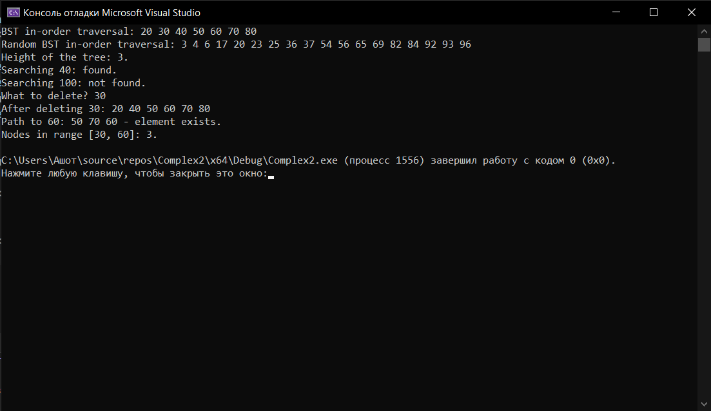

# Лабораторная работа №9: Бинарное дерево. Обходы. BST
**Вариант:** 12  
**Технология:** C++  

## Содержание
- [Лабораторная работа №9: Бинарное дерево. Обходы. BST](#лабораторная-работа-9-бинарное-дерево-обходы-bst)
  - [Содержание](#содержание)
  - [Цель работы](#цель-работы)
  - [Теоретическая часть](#теоретическая-часть)
  - [Выполнение индивидуального задания](#выполнение-индивидуального-задания)
    - [Результат работы](#результат-работы)
  - [Ответы на вопросы](#ответы-на-вопросы)
  - [Вывод](#вывод)

## Цель работы
1. Реализовать структуру данных «бинарное дерево» и изучить различные способы его обхода (прямой, симметричный, обратный, уровневый).  
2. Реализовать бинарное дерево поиска (BST) с операциями вставки, удаления и поиска.  
3. Освоить применение рекурсии для работы с деревьями.  
4. Проанализировать сложность операций в BST.  
5. Научиться визуализировать структуру дерева.  

## Теоретическая часть
**Бинарное дерево** - это иерархическая структура данных, в которой каждый узел имеет не более двух потомков: левый и правый.  

## Выполнение индивидуального задания
В рамках индивидуального задания необходимо реализовать бинарное дерево со всеми основными операциями (симметричный обход, вставка, поиск, удаление, высота, максимальный и минимальный элементы), а также нахождением пути от корня до заданного узла, подсчётом узлов в указанном диапазоне и случайным заполнением дерева.  

Код для индивидуального задания
``` cpp
#include <iostream>
#include <queue>
#include <random>

using namespace std;

struct Node {
    int data;
    Node* left;
    Node* right;
    Node(int val) : data(val), left(nullptr), right(nullptr) {}
};

class BST {
private:
    Node* root;

    Node* insert(Node* node, int key) {
        if (node == nullptr) return new Node(key);
        if (key < node->data) node->left = insert(node->left, key);
        else if (key > node->data) node->right = insert(node->right, key);
        return node;
    }

    Node* search(Node* node, int key) {
        if (node == nullptr || node->data == key) return node;
        if (key < node->data) return search(node->left, key);
        return search(node->right, key);
    }

    Node* findMax(Node* node) {
        while (node->right != nullptr) node = node->right;
        return node;
    }

    Node* findMin(Node* node) {
        while (node->left != nullptr) node = node->left;
        return node;
    }

    Node* remove(Node* node, int key) {
        if (node == nullptr) return nullptr;

        if (key < node->data) node->left = remove(node->left, key);

        else if (key > node->data) node->right = remove(node->right, key);
        else {
            if (node->left == nullptr && node->right == nullptr) {
                delete node;
                return nullptr;
            }
            else if (node->left == nullptr) {
                Node* temp = node->right;
                delete node;
                return temp;
            }
            else if (node->right == nullptr) {
                Node* temp = node->left;
                delete node;
                return temp;
            }
            else {
                Node* minNode = findMin(node->right);
                node->data = minNode->data;
                node->right = remove(node->right, minNode->data);
            }
        }
        return node;
    }

    bool findPath(Node* node, int key) {
        if (node == nullptr) return false;

        cout << node->data << ' ';

        if (node->data == key) return true;

        if (key < node->data)
            return findPath(node->left, key);
        else
            return findPath(node->right, key);
    }

    int countInRange(Node* node, int min, int max) {
        if (node == nullptr) return 0;

        int count = 0;

        if (node->data >= min && node->data <= max)
            count++;

        if (node->data > min)
            count += countInRange(node->left, min, max);

        if (node->data < max)
            count += countInRange(node->right, min, max);

        return count;
    }

    void inOrder(Node* node) {
        if (node == nullptr) return;
        inOrder(node->left);
        cout << node->data << " ";
        inOrder(node->right);
    }

    void destroy(Node* node) {
        if (node == nullptr) return;
        destroy(node->left);
        destroy(node->right);
        delete node;
    }

    int height(Node* node) {
        if (node == nullptr) return 0;
        return 1 + max(height(node->left), height(node->right));
    }

public:
    BST() : root(nullptr) {}

    ~BST() { destroy(root); }

    void insert(int key) { root = insert(root, key); }

    bool search(int key) { return search(root, key) != nullptr; }

    void remove(int key) { root = remove(root, key); }

    bool findPath(int key) { return findPath(root, key); }

    int countInRange(int min, int max) { return countInRange(root, min, max); }

    void print() {
        inOrder(root);
        cout << endl;
    }

    int getHeight() { return height(root); }
};

int main() {
    BST tree;

    tree.insert(50);
    tree.insert(30);
    tree.insert(70);
    tree.insert(20);
    tree.insert(40);
    tree.insert(60);
    tree.insert(80);
/*
       50
     /    \
    30     70
   /  \   /  \
  20  40|60  80
*/
    BST randTree;

    random_device rd;
    mt19937 gen(rd());
    uniform_int_distribution<> dist(1, 100);

    for (int i = 0; i < 20; i++) {
        int num = dist(gen);
        randTree.insert(num);
    }

    cout << "BST in-order traversal: ";
    tree.print();
    cout << "Random BST in-order traversal: ";
    randTree.print();

    cout << "Height of the tree: " << tree.getHeight() << ".\n";
    cout << "Searching 40: " << (tree.search(40) ? "found." : "not found.") << '\n';
    cout << "Searching 100: " << (tree.search(100) ? "found." : "not found.") << '\n';

    int erasingKey{};
    cout << "What to delete? ";
    cin >> erasingKey;
    if (tree.search(erasingKey)) {
        tree.remove(erasingKey);
        cout << "After deleting " << erasingKey << ": ";
        tree.print();
    }
    else
        cout << "Element not found.";

    cout << "Path to 60: " 
        << (tree.findPath(60) ? "- element exists." : "... - element not found.") << '\n';

    cout << "Nodes in range [30, 60]: "
        << tree.countInRange(30, 60) << ".\n";

    return 0;
}
```

___
### Результат работы

*Результат работы программы*

## Ответы на вопросы
1. Что такое бинарное дерево? Из каких элементов оно состоит?  
Бинарное дерево - это структура данных, в которой каждый узел имеет не более двух потомков: левого и правого. Состоит из корня (root), узлов (nodes) и рёбер (связей между узлами).
2. В чём отличие бинарного дерева от бинарного дерева поиска (BST)?  
В обычном бинарном дереве порядок элементов произвольный. В BST все элементы левого поддерева меньше корня, а правого - больше.
3. Какие существуют виды обхода бинарного дерева? В чём их особенности?  
- In-order (Л-К-П) - левое поддерево, корень, правое поддерево.
- Pre-order (К-Л-П) - корень, левое поддерево, правое поддерево.
- Post-order (Л-П-К) - левое поддерево, правое поддерево, корень.
- Level-order - обход дерева по уровням, сверху вниз.
4. Какой обход даёт отсортированную последовательность для BST?  
In-order (симметричный обход).
5. Какова сложность операций поиска, вставки и удаления в BST? От чего она зависит?  
- В среднем (O(log n)).
- В худшем случае (O(n)).
Сложность зависит от высоты дерева и степени его сбалансированности.
6. Что происходит с BST, если вставлять элементы в отсортированном порядке?  
Дерево вырождается в список, поэтому операции поиска, вставки и удаления становятся (O(n)).
7. Какие три случая нужно рассмотреть при удалении узла из BST?  
1. Узел является листом (нет потомков) - удаляется.
2. Один потомок - заменяется его потомком.
3. Два потомка - заменяется минимальным элементом правого поддерева и удаляется.
8. Как найти наименьший элемент в BST? Наибольший?  
- Наименьший - идём по левым потомкам до конца.
- Наибольший - идём по правым потомкам до конца.
9. Как вычислить высоту бинарного дерева рекурсивно?  
Высота равна единице плюс максимум высот левого и правого поддеревьев: H = 1 + max(H_left, H_right)
Для пустого дерева высота равна 0.
10. Что такое наименьший общий предок (LCA) двух узлов в дереве?
Это самый нижний узел дерева, который является предком обоих заданных узлов.
11. Как проверить, является ли бинарное дерево BST?
Рекурсивно проверять, что каждый узел находится в допустимом диапазоне значений: между минимальной и максимальной границами.
12. Что такое сбалансированное дерево? Почему это важно для производительности?
Это дерево, в котором высоты левого и правого поддеревьев отличаются незначительно. Балансировка позволяет сохранять сложность основных операций (O(log n)).
13. Как преобразовать несбалансированное BST в сбалансированное?
Выполнить in-order обход, сохранить элементы в отсортированный массив, затем рекурсивно выбирать середину массива как корень и строить левое и правое поддеревья.
14. Как восстановить дерево по массиву обхода (in-order + pre-order)?
Первый элемент pre-order является корнем. Находим его в in-order: слева находятся элементы левого поддерева, справа - правого. Рекурсивно повторяем процесс для обоих поддеревьев.
15. Как реализовать итеративный (не рекурсивный) обход бинарного дерева?
Использовать стек (stack) вместо рекурсии для поиска в глубину (DFS) или очередь (queue) для обхода по уровням (BFS). В стек или очередь добавляются узлы для последующей обработки.  

## Вывод 
В ходе выполнения лабораторной работы была реализована структура данных «бинарное дерево» и изучены различные способы его обхода (прямой, симметричный, обратный, уровневый), реализовано бинарное дерево поиска (BST) с операциями вставки, удаления и поиска, освоено применение рекурсии для работы с деревьями, проанализирована сложность операций в BST, получены навыки визуализации структуры дерева.  
